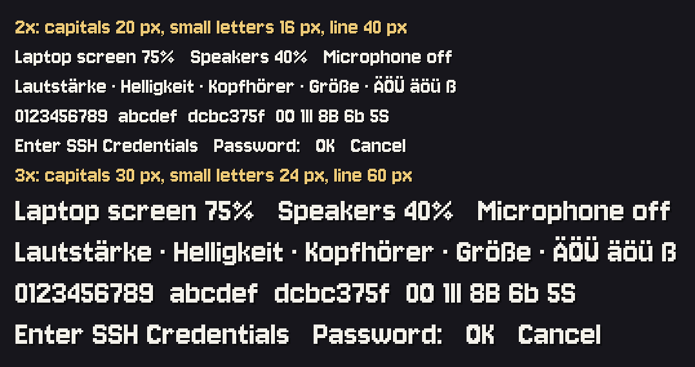
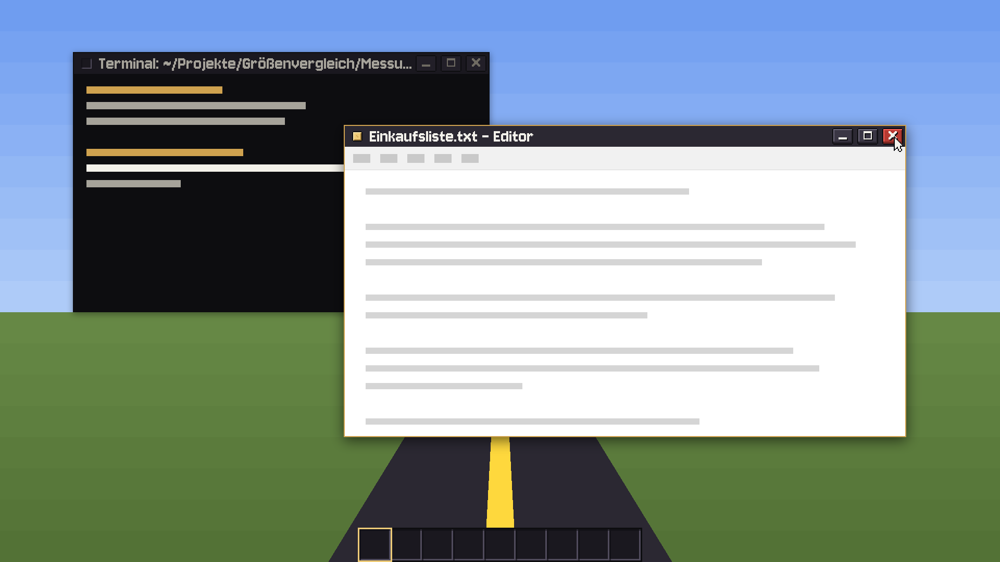
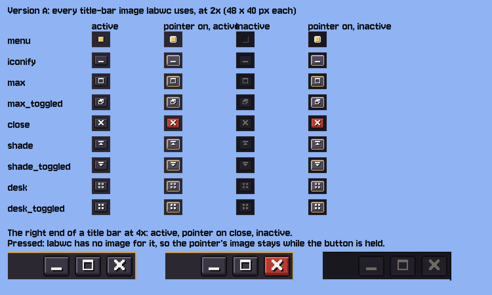
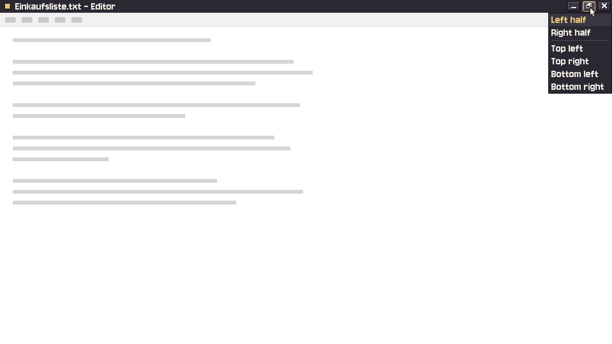
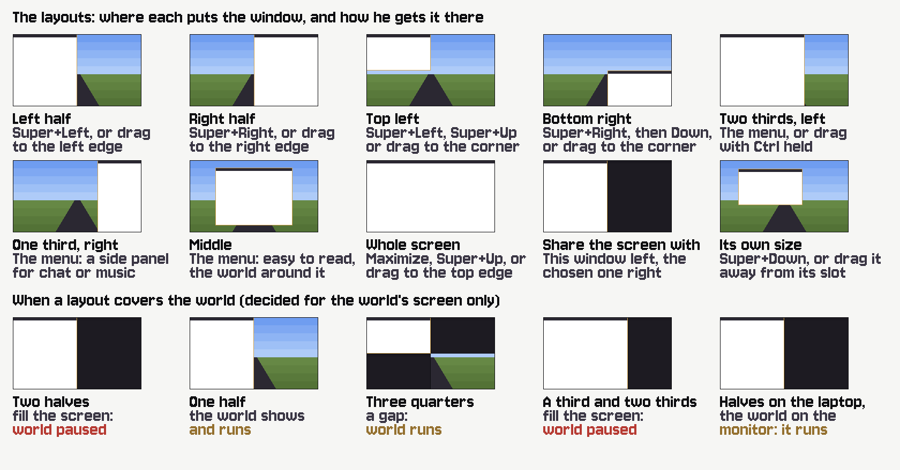
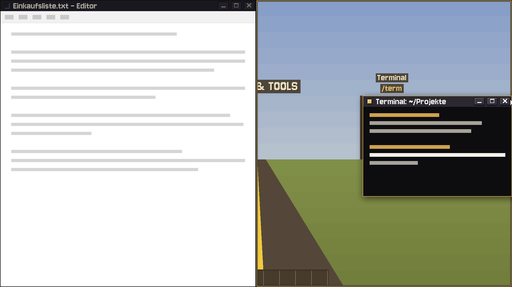
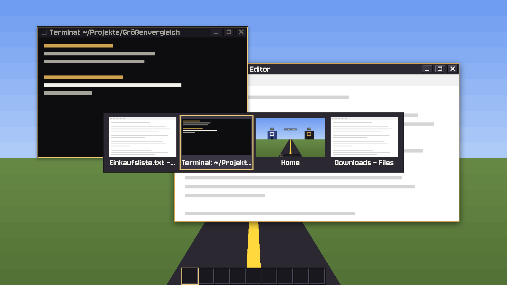
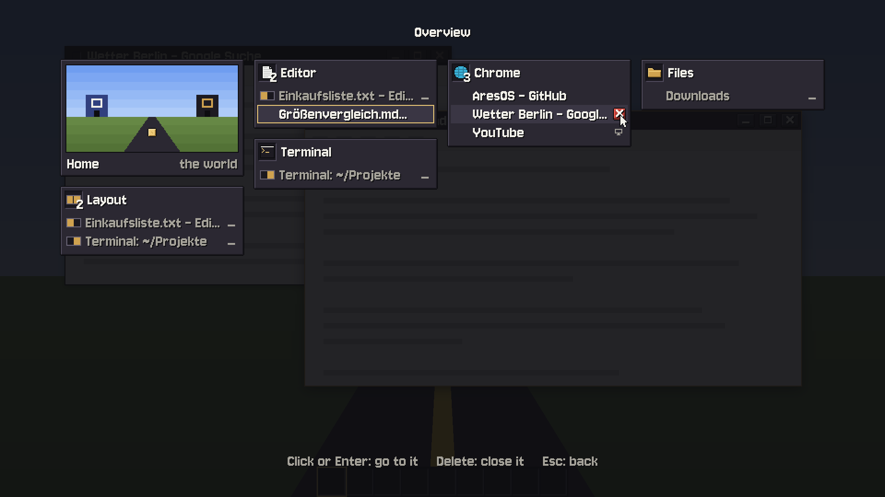
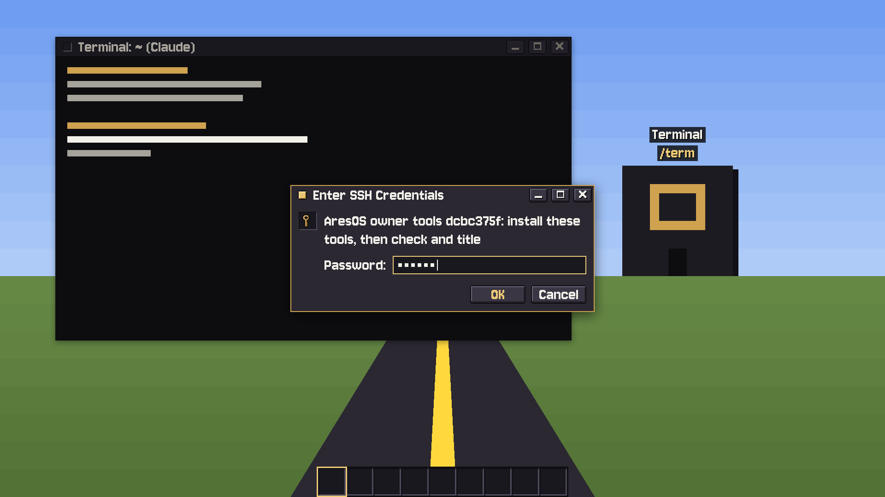

# The desktop's pieces: how they look and how they behave

**Status:** a finished design study (package 312, `briefs/312-component-study.md`, four steps on 2026-11-19 and
2026-11-20). It covers the theme layer, version A's colours and font, the grid, version B's runtime contract, the
brightness and volume indicator, the window frame, window layouts, app switching, the app overview, the password
window, and the settings the owner chose. Nothing here is built, and this study changes no image, theme, `rc.xml` or
mod file.

**What it is for.** One design for the normal desktop pieces of AresOS, so each can be built from it in its own
package: the brightness and volume indicator, the window frame and its buttons, minimize, window layouts, app
switching, an app overview, and the password window. The Minecraft look comes first; a look in the style of the Ares
apps comes later and is not designed here.

**Two looks, for the owner to choose between.**

- **Version A** is our own pixel art. It is in this repo: `docs/design/components/`.
- **Version B** is Minecraft's real textures and font, read at run time from the game that AresOS installs. The repo
  is public and nothing of Mojang's may be in it, so B is **described in words here and never shown**. Its pictures
  have IDs (`B-01`, `B-02`, …) and are kept privately by the lead (`linux-desktop`), who shows them to the owner.

**Words used below**

| Word | Meaning |
|---|---|
| Source pixel | One pixel of a sprite as it is drawn. |
| GUI unit | Minecraft's unit for its interface. One unit is one source pixel. A vanilla button is 200 by 20 units. |
| Scale | How many screen pixels one GUI unit takes: 2x, 3x, 4x. Always a whole number. |
| Screen pixel | One pixel of the laptop's 1920 by 1080 panel. |
| Passive piece | Shows something and never takes the keyboard or the mouse (an indicator, a hint). |
| Interactive piece | He chooses something in it (a layout picker, the overview). |
| Look | One set of colours, sprites and font for all pieces. A and B are two looks. |

Contents: [1 The theme layer](#1-the-theme-layer) · [2 Version A's colours and font](#2-version-as-colours-and-font) ·
[3 The grid and the scales](#3-the-grid-and-the-scales) · [4 The pieces](#4-the-pieces) ·
[5 Version B's runtime contract](#5-version-bs-runtime-contract) ·
[6 What each look costs, and the build order](#6-what-each-look-costs-and-the-build-order) ·
[7 Questions for the owner](#7-questions-for-the-owner) · [8 What the next hub session checks](#8-what-the-next-hub-session-checks)

---

## 1. The theme layer

**The rule.** Every piece has two halves that never mix:

- **Function:** what it shows, which keys and clicks it answers, where its parts sit relative to each other, which
  screen it is on, what it does with the keyboard. This is the piece's program.
- **Look:** colours, sprites, font, and the few sizes that follow from them (how high a capital letter is, how thick
  a plate's edge is). This is data in one place, the **look pack**.

A piece asks the look pack for parts by what they are for, never by what they look like: "the plate", "a lit step",
"the text colour for a value", never "dark grey" or "gold". Swapping the pack changes how every piece looks and
nothing about what it does. That is how A and B fit the same pieces today, and how the Ares-apps look can come later
without rebuilding them.

**One look at a time.** After step 1 the owner chose a setting for it: A, B or C, with B as the default (the brief,
"The owner's decision after step 1"). C is the game's own controls where the game has them, and B elsewhere. Section
4.7 designs this setting and the indicator's two; section 4.2 says what the frame needs from it. No Ares-apps look in this study.

### The look pack

One folder, `/usr/share/aresos/look/` in the image (version A):

| In it | What |
|---|---|
| `look.json` | Colours by role (`ink`, `value`, `quiet`, `warn`, `outline`), sizes in GUI units (capital height, the gap between two lines, a plate's padding), and one entry per sprite: its file, its size, its nine-slice insets and its states. |
| `sprites/*.png` | Each sprite once, at one pixel per GUI unit. Programs enlarge them in whole steps. |
| The font | For A a normal font file installed in the image (section 2). For B the game's letter sheets (section 5). |

The study's own drawing code is built the same way, as a proof: `reviews/312-component-study/tools/look.py` has one
function that lays out the indicator and knows no colour or pixel, and it drew both A's public pictures and B's
private ones from two packs. The two looks even differ in their sizes (A's capitals are 10 units high, the game's
are 7), and the same layout code coped.

### Where the look lives for each kind of piece

| Kind of piece | Who draws it | Function lives in | Look lives in |
|---|---|---|---|
| Window frame: title bar, its buttons, border, labwc's menus, Alt+Tab, the snapping preview | labwc | labwc and `rc.xml` (button order, keys, mouse) | A labwc theme folder (`themerc` and one image per button and state), **generated from the look pack** by a script, as `reviews/window-design-v1/draw-buttons.py` generates Ares-Crown's today. Plus five kinds of line in `rc.xml` that labwc keeps outside the theme: the theme's name, the fonts, the corner radius, shadows on or off, the Alt+Tab style. |
| New pieces: the indicator and the overview | A small layer-shell program each | That program | The selected look pack, read before each showing, even if the program is still running. It copies sprites and letters onto its surface at a whole scale. |
| The mod's own screens | The game | The mod | The game's own widgets, as today (package 48 kept vanilla buttons on purpose). A's sprites sit on the game's grid (section 3), so the mod could ship them as its widget textures later; that is the owner's choice then, not part of these builds. |
| The password windows' insides | Qt (`ksshaskpass`, polkit's KDE agent) | Those programs, unchanged | A Qt style sheet in the image, generated from look A's pack and **the same in every look** (section 4.6; its build needs its own review on the owner tools' checked path). |
| Programs that draw their own bar (Chrome, GNOME apps, frameless Electron) | The program | The program | Not ours. Only the button-order setting reaches them (`docs/design/WINDOWS.md`). |

### What the separation costs

1. **One more thing to keep in step.** The pack is the source; labwc's theme folder and the Qt style sheet are
   generated from it. The image checks already pin Ares-Crown's checksum and file count; the same kind of check must
   show that the generated files match the pack.
2. **Layout from the pack's sizes.** A piece may not hard-code "the text is 10 units high". It asks. That is a little
   more code in every piece, and every piece must be looked at in each look it ships with.
3. **labwc keeps part of its look in `rc.xml`.** A change of look is the theme folder, those `rc.xml` lines and the
   image check's pin in one commit, and `rc.xml` changes go to `linux-aresos` first.
4. **When a change of look shows.** Our programs load the current pack before showing a surface and redraw a
   visible surface when the effective look changes (sections 4.7 and 5). labwc rereads its theme on
   `labwc --reconfigure`, so the frame can change while windows are open (section 4.2).
5. **labwc cannot do everything a look may want** (no pressed button image, one border colour, soft shadows only;
   WINDOWS.md lists it). A look has to work within that for the frame. Step 2 says what that means for A and B.

What it does not cost: no second copy of any piece. A look is data.

---

## 2. Version A's colours and font

### Where A starts from

Package 31's unshipped **Ares-Block** study (`docs/design/WINDOWS.md`) is the starting point. A keeps its
construction and changes its colours.

- **Kept:** everything on a pixel grid, a hard dark outline, square corners, raised plates and sunken slots made of
  one light and one dark edge, pixel glyphs, the pointer lighting a button, red for close, and the font Jersey 10.
- **Changed: the greys become dark stone and gold.** Ares-Block's flat light greys are the game's own inventory
  look redrawn by hand. Version B does that with the real thing, so a light grey A would only be a weaker B. And
  package 31 already found that a light game panel around Chrome or an editor "reads as a costume after a while".
  A instead takes the materials AresOS already has in its own world: the dark stone pad he stands on and the dark
  paving of the roads, the gold block under his feet, the dark plates his apps' names stand on. Those are also
  Ares-Crown's colours (near-black, off-white, one gold), so A's pieces sit next to today's window frame while the
  pieces arrive one by one.
- **Corrected: the font's size.** Ares-Block set Jersey 10 at 21 pt and noted that "a few letter edges still land on
  half pixels". The font's own grid explains it (below): 21 pt is one and a half times its drawn size. The sizes that
  land on whole pixels are 14, 28 and 42 pt.

### The colours


| Name | Colour | For | From |
|---|---|---|---|
| `outline` | `#0d0d10` | The one-unit outline of every plate and button; the text's hard shadow | Ares-Crown's wall |
| `stone-950` | `#121117` | The dark edge of a sunken slot | new |
| `stone-900` | `#1a181f` | The floor of a slot and of the bar's trough | new |
| `stone-800` | `#221f28` | An unlit step, a pressed button, a button's lower lip | new |
| `stone-700` | `#2b2832` | A plate's face | the road's paving in the laptop home's day look |
| `stone-600` | `#3a3644` | A button's face | new |
| `stone-500` | `#504b5c` | The light edge of a plate | new |
| `stone-400` | `#6c6779` | The light edge of a button; an icon of something that is not there | new |
| `stone-300` | `#948fa0` | Steps of a muted level | new |
| `ink` | `#f3f1ea` | Text and icons | Ares-Crown's ink |
| `ink-quiet` | `#a6a39a` | A second line; a muted icon | Ares-Crown's quiet ink |
| `ink-dim` | `#6f6b62` | Text on a button that cannot be used | the laptop home's quiet ink |
| `gold-100` | `#f7e2a6` | A highlight on gold | new |
| `gold-300` | `#edca77` | A value, the chosen thing, the pointer on a button | Ares-Crown's gold |
| `gold-500` | `#cfa24f` | Lit steps | the laptop home's gold |
| `gold-700` | `#94702f` | The shade on gold | new |
| `gold-900` | `#5b431b` | A part step | new |
| `red-300` | `#ff6257` | Muted, off, close | the Games group's colour (`AppGroup`) |
| `red-600` | `#b63a32` | The shade on red; the face of close under the pointer | new |
| `red-800` | `#7c2620` | The lip of a red button (step 2) | new |

The "stone" steps are one cool, slightly violet grey in eight brightnesses, built outwards from the paving colour.
The other three group colours (`#3AB3DA`, `#C774F2`, `#FED83D`) stay what they are, the colours of app groups, and
are not used for the desktop's own parts.

**Rules for using them**

- Gold means lit, chosen or "this is the number". Red means off, muted or close. Nothing else is coloured.
- Text is `ink` with a hard shadow one unit down and one unit right, in `outline`. That is how the laptop home's day
  look already writes over the world.
- Sprites are flat: no gradients, no see-through pixels except the cut corners. labwc cannot blur, and flat sprites
  survive every whole scale.

### The font: Jersey 10



| | |
|---|---|
| File | `Jersey10-Regular.ttf`, 77,732 bytes (78 KB) |
| SHA-256 | `db9cbd091617048a145d249daa2b815fe7083be6ab66ac26626e21a4e01c3e82` (the same file WINDOWS.md recorded; downloaded again on 2026-11-19) |
| Official source | Google Fonts, `ofl/jersey10` in `github.com/google/fonts`; the project is `github.com/scfried/soft-type-jersey` |
| Licence | SIL Open Font License 1.1, © 2023 The Soft Type Project Authors. We may ship it with its licence text. |
| Designer | Sarah Cadigan-Fried |

**Its grid, measured.** The font has 1400 units per em and is drawn in squares of 75 units. In those squares a
capital is 10 high, a small letter 8, a descender 2, and a line is 20: exactly one widget row of 20 GUI units. So one
font square is one GUI unit, and:

| Scale | Font size that lands on whole pixels | Capitals | A line |
|---|---|---|---|
| 1x | 14 pt (18⅔ px em) | 10 px | 20 px |
| 2x | 28 pt | 20 px | 40 px |
| 3x | 42 pt | 30 px | 60 px |

labwc takes whole points only, and 14, 28 and 42 are whole. *Checked:* drawn with FreeType at 56 px (three pixels per
square), the test line had no grey pixel at all, and the letters in the pictures here are every third pixel of that
drawing. *Not checked yet:* labwc's and Qt's own text drawing at these sizes; the first build that
uses the font checks it in a private labwc.

**Letters it has.** Basic Latin, Western and Central European letters including `Ä Ö Ü ä ö ü ß ẞ` and `€` (the
font's character list as fontconfig reads it). It has no Greek or Cyrillic. Where a letter is missing, labwc and Qt
fall back to the system font by themselves; our own programs must draw text through the system's text library for the
same reason, not from a fixed letter table.

**Not derived from Minecraft's font.** It is one of a family of sports-shirt lettering in four sizes (Jersey 10, 15,
20, 25) with its own public source. It is built differently: capitals 10 squares high with strokes 2 squares wide,
where the game's letters are 7 high with strokes of 1. A private check compared the bitmaps letter by letter: of the
94 printable ASCII letters, none is the same in the two fonts.

**Its weak spot.** `0` and `O` look the same, and so do `1`, `l` and `I` (bottom of the picture). Among the sixteen
characters a fingerprint uses (`0`–`9`, `a`–`f`) I see no pair that can be confused. Section 4.6 proves it (`A-18`), so the fallback,
JetBrains Mono from the R29 image, is not needed.

**The other candidate.** Pixelify Sans (OFL, SHA-256 `9ba86cd0…89e8a5` of the variable file from `ofl/pixelifysans`)
did not land on whole pixels at any size from 8 to 48 px in the same test, so its letters would always have soft
edges. Not looked at further. Silkscreen has no small letters. Fonts made to imitate the game's letters were not
considered at all.

**No font is committed by this study.** Shipping Jersey 10 is an image change for the first build package that needs
it: the file and its licence text in `/usr/share/fonts/aresos/`, the README's licence list, the font cache step
(`fc-cache --system-only --really-force`, see STATE.md's font-cache note) and the image checks.

---

## 3. The grid and the scales

**On the laptop's 1920 by 1080 panel**

| Scale | The screen in GUI units | A 20-unit row | A's capitals | The same in the game |
|---|---|---|---|---|
| 2x | 960 × 540 | 40 px | 20 px | GUI Scale 2 |
| 3x | 640 × 360 | 60 px | 30 px | GUI Scale 3 |
| 4x | 480 × 270 | 80 px | 40 px | GUI Scale 4, which is also what "Auto" gives at this resolution |

**Two scales, by what a piece belongs to** (a first proposal; steps 2 to 4 confirm it for their pieces):

- **2x for what is attached to a window:** the frame and its buttons. A 20-unit title bar is 40 px, close to
  Ares-Crown's 36 px. At 3x it would be 60 px, far too much of every window.
- **Medium (3x) by default for the indicator.** It is seen at a glance and from further away, and it sits near the
  game's own interface, whose pixels are 3 or 4 screen pixels wide.

Each mockup says its scale. `A-05` shows the indicator at 2x, 3x and 4x in real screen pixels.

**For the lead:** record the game's actual GUI scale and try small, medium and large beside its hotbar at that
scale (section 8).

**Rules for every sprite**

- One PNG per sprite and state, one pixel per GUI unit. Sizes and insets are whole units.
- Enlarged only by whole factors, without smoothing. Text and parts are placed on whole units.
- Nine-slice: the corners are copied, the edges and the middle are **repeated**, never stretched (that is also what
  the game does with a nine-slice sprite, so the mod can use the same files).
- An outline is one unit. A button is 20 units high.

**Version A's sprites so far** (`docs/design/components/sprites/`, made by `tools/draw_a.py`):


| Sprite | Source size | Nine-slice insets | States | Used by |
|---|---|---|---|---|
| `plate` | 9 × 9 | 3 on every side | one | layer-shell programs; later the Qt style sheet and the mod |
| `slot` (also the bar's trough) | 7 × 7 | 2 on every side | one | the same |
| `button` | 9 × 9, built to 20 high | left 3, top 3, right 3, bottom 4 | normal, pointer on it (`-hover`), pressed, not available (`-disabled`) | the same. **A first pass:** step 2 owns the buttons and may redraw them. |
| `step-*` | 6 × 4 | none | lit, unlit, muted, part, limit | the indicator |
| `sun`, `speaker`, `speaker-muted`, `microphone`, `microphone-off` | 16 × 16 | none | each also drawn in one grey as "not there" | the indicator |
| `button-close-hover` | 9 × 9 | as `button` | one | the frame's close under the pointer; later any button that deletes or closes |
| `gold-block`, `gold-block-hover` | 10 × 10 | none | normal, pointer on it | the window-menu button |
| `frame/*.png` | 24 × 20 | none | labwc's 36 images: nine buttons, each normal and under the pointer, on an active and an inactive window | labwc only, doubled to 48 × 40 px (section 4.2) |
| `layout/layout-*.png` | 16 × 10 | none | one: labwc shows a menu icon unchanged on the chosen row | the layout menu's 11 pictograms, as named icons (section 4.3) |
| `home-picture` | 188 × 96 | none | one | the overview's Home card, in every look (section 4.5) |
| The overview's close button | 14 × 14, from `button` and `button-close-hover` | as `button` | normal, pointer on it | the overview (section 4.5) |
| A text field | from `slot`, with a one-unit `gold-300` edge while it has the keyboard | 2 on every side | with and without the keyboard | the password windows' style sheet (section 4.6) |

labwc's title-bar buttons are finished images, not nine-slices: one per button and state at a fixed size, and no
pressed state. They are put together from the sprites above and 8 × 8 pictograms (`GLYPHS` in `look.py`), and the
theme generator doubles them (section 4.2).

---

## 4. The pieces

### 4.1 The brightness and volume indicator

*Passive. Complete in both looks.*

**What he sees.** He presses a brightness or volume key. A small plate appears at the top centre of the screen: an
icon, the name of the thing that is changing, its level as a number, and a bar of twenty steps. Each press moves the
bar by one step. A moment after the last press it is gone. He never has to click it, and it never takes the keyboard
or the mouse from what he is doing, in an app or in the world.


*Left over the world's sky colour, right over a white page. All values are made up.*

**Which keys show it, and what each does.** These are the six keys `rc.xml` binds today (lines 24 to 29). Only they
show it: a change made in a program's own volume slider does not.

| Key | What changes | What appears |
|---|---|---|
| Brightness up, down | The laptop panel's backlight by 5 %, never below 1 % (as today) | Sun, "Laptop screen", the number, the bar |
| Volume up | The sound output by 5 %, never above 100 % (as today). **New: it also ends mute**, as every phone and both big desktop systems do. | Speaker, the output's name, the number, the bar |
| Volume down | The sound output by 5 %. Mute stays as it is. | The same; while muted the bar moves in grey |
| Mute | Speaker mute on or off | Muted: a crossed speaker, "muted" in red, the bar in grey **at the level it will come back to**. Unmuted: the normal picture. |
| Microphone mute | Microphone on or off | A short plate without a bar: "Microphone" and "on", or a crossed microphone and "off" in red. There is no bar because no key changes the microphone's level. |

**The levels it shows**

- Twenty steps of 5 %, the keys' own step, so one press is one step.
- A level between two steps (a program set 62 %) lights the next step dimly. The lowest brightness, 1 %, shows as that
  dim first step: the screen is on, but there is nowhere lower to go.
- At 100 % a further press changes nothing, so the last step flashes bright for a moment. A key press is never
  silent.
- A volume above 100 % that a program set shows a full bar and the true number.

**The name says what is changing.** Not "Volume" but where the sound goes: "Speakers", "Headphones", "HDMI", or a
Bluetooth device's own name, cut to fit. Not "Brightness" but "Laptop screen", because with a monitor attached that
is the only screen these keys reach. If the output's kind cannot be found it says "Volume".

**Holding a key.** labwc repeats a held key's action (by default 25 times a second after 0.6 seconds), as it does
today. The bar runs with it and the plate stays for as long as the key is held. Whether that speed feels right is
something only trying it on the laptop shows; the build can drop repeats that come faster than a set rate if not.

**When it disappears.** 1.5 seconds after the last key event, at once and without a fade. Pressing another of the six
keys while it shows changes the plate in place and starts the 1.5 seconds again. There is only ever one.

**Which screen**

- **Volume and microphone:** the screen the pointer is on. In the world that is the world's screen, because the game
  holds the pointer there; in an app it is where he is working. It is also where package 23c opens apps.
- **Brightness:** always the laptop's own screen (the output whose name starts with `eDP`, as the laptop home finds
  it), also when the pointer is on the monitor. That is the screen that changes, and the name on the plate says so.
- With one screen, as today, all of this is the same screen.

**When there is nothing to control.** The key still answers, with a short plate and a greyed icon:

| Case | It says |
|---|---|
| No backlight device (a desktop PC, a VM) | "Brightness" / "not available here" |
| The laptop's screen is off (lid closed, monitor only) | "Laptop screen" / "is off", on the pointer's screen |
| No sound output | "Sound" / "no output found" |
| No microphone | "Microphone" / "none found" |

**Where on the screen: top centre.** Eight units below the top edge.


*1920 × 1080. The scene is a drawing of our own in the day colours of the laptop home; the row of slots at the bottom
stands for the game's hotbar and is version A's slot sprite, not the game's bar.*

- It is where the game itself shows a named bar (a boss's), so it reads as part of the world.
- It never meets the hotbar, the hearts above it, the chat line or the laptop home's hotbar and typing line, which
  all live at the bottom.
- It is in the same place over the world and over an app.
- Its cost: over a maximized app it covers the middle of the title bar and of whatever lies just under it, such as a
  browser's address bar, for those 1.5 seconds: [`A-08`](components/A-08-indicator-over-app.png).

The alternative is the bottom centre, above the hotbar and the hearts, where Windows 11 puts it:
[`A-07`](components/A-07-indicator-bottom.png). It is nearer to where his eyes are in the world, but it sits in the
middle of the view there and over a film's subtitles in an app. The owner made the place a setting, with the top
centre as its default (board #409; section 4.7).

**How big.** 175 × 30 units. Shipped at 3x that is 525 × 90 px.


Small (2x, 350 × 60 px) is the size of a Windows flyout and easy to miss from a chair's distance. Large (4x,
700 × 120 px) is closest to the game's interface at 4x. The desktop defaults to medium (3x), as the owner chose
(board #409). Check all three sizes beside the world at the game's actual GUI scale (sections 4.7 and 8).

**With the world**

- It is a layer-shell surface on the **overlay** layer, above every window including fullscreen ones, with keyboard
  mode "none" and an empty input region. So it cannot get the keyboard, clicks fall through it, and the game's hold
  on the pointer is not touched (package 40's focus rules).
- It is not a window. `aresos-shell` never sees it, it is not in Alt+Tab, and it can never count as covering the
  world.
- It binds no new key. Super stays free.

**Where we lean on Windows, and what is our own**

| Like Windows | Our own |
|---|---|
| A small plate that the keys bring up and that leaves by itself | It names the device, so he sees where the sound goes and which screen dims |
| A bar and a number | Twenty steps that match the keys: he can count presses |
| A crossed icon for mute | Muted keeps the level readable, in grey, so he knows what unmuting brings back |
| | The limit flashes and a missing device answers: no key press is ever silent |
| | It sits where the world shows its own bars, not where a taskbar would be |

**Version B: `B-01` to `B-06`** (private pictures; `B-03` is the sheet with A and B side by side).

- **`B-01`, the same layout in the game's art.** The plate is the game's "now playing" toast, a dark rounded panel.
  The level is the game's boss bar in yellow with its 20-notch overlay, white when muted. Text is the game's font,
  white with yellow numbers and its usual shadow. Icons are game items, because the game has no sun, loudspeaker or
  microphone picture at icon size (its sun is a 32 × 32 sky texture on black): a lantern for brightness, a bell for
  volume, the bell under the barrier sign for muted, and the two chat-bubble buttons of the social screen for the
  microphone. It is 217 × 32 units, 651 × 96 px at 3x: wider than A, because the game's bar is 182 units long and
  cannot be shortened without redrawing it.
- **`B-02`, the game's own control.** Each state as the options screen's slider, 200 × 20 units, with the text
  inside it ("Laptop screen: 75%"), and the microphone and the missing-device cases as a plain game button. No
  plate, no icon. It is the most Minecraft of all the forms and needs no stand-in icons, but a slider looks like
  something to drag, and this one cannot be dragged.
- **`B-04`, `B-05`, `B-06`:** B at the top centre over the same drawn scene and over the app, and at 2x, 3x and 4x.

**What he would notice between A and B on this piece**

- **The letters.** At the same scale A's are larger and heavier (capitals 10 units, strokes 2) and the game's are
  smaller and thin (7 and 1). At 3x that is 30 px against 21 px. A reads from further away; B is unmistakably the
  game.
- **The icons.** A has a sun, a speaker and a microphone. B has a lantern, a bell and chat bubbles, which have to be
  learned.
- **The plate.** A's is AresOS's dark stone with a gold bar and matches today's window frame. B's is the game's
  toast and matches the mod's own screens.
- **The steps.** A's twenty steps are even and separate. The game's bar is one strip of 182 units with a 20-notch
  overlay, and twenty does not divide 182 evenly.

**What it is built from**

| | |
|---|---|
| Draws it | One small layer-shell program, called `aresos-indicator` here. Not the mod: it has to show over apps too, and one program for both cases is simpler than two. |
| Existing things it uses | gtk4-layer-shell, GTK and Cairo, which the R29 image brings for the laptop home; `brightnessctl` and `wpctl`, already in the image; the look pack. |
| New: the keys' command | The six `rc.xml` lines call one small script (`/usr/libexec/aresos-level <action>`) instead of `brightnessctl` and `wpctl` directly. It makes the change first, with the same commands, steps and limits as today, then tells the indicator the new state. **If the indicator is broken or missing, the keys still work.** It is also the one place that holds the step size and the "volume up ends mute" rule. |
| New: the program | Started by the first key press, stays while it is used, ends after a minute without one, so it costs no memory at rest (a GTK program is about 50 MiB while it runs, by the laptop home's measurement). GLib's own single-instance start through the session bus does this without code of ours, if the session has a bus; otherwise the script starts it. The builder checks which. |
| `rc.xml` | Six changed lines. They go to `linux-aresos` first, and the image checks that know today's lines move in the same commit. |
| Size | One small package: the script (about 40 lines), the program (about 300), the look pack's first files, the image and its checks, and tests in a private labwc. One or two builder steps. In look A only; B adds section 5's shared work first. |

**What the build must test** (in a private headless labwc, as packages 31 and 23c test):

- The world keeps the pointer and the keyboard while the plate appears, changes and disappears (a test client that
  holds a pointer lock and counts its key events).
- A click at the plate's position reaches the window below it.
- It shows above a fullscreen window.
- With the indicator's program removed, each key still changes its level.
- A held key: the bar follows without piling up work, and the plate leaves 1.5 seconds after release.
- Each "nothing to control" case, with the device taken away.
- Two outputs: brightness on the `eDP` one, volume on the pointer's.

**Decisions taken here, with reasons** (all can change later without redesign)

| Decision | Why |
|---|---|
| The keys show it; other changes do not | He asked for an answer to the keys. A plate that pops up when a program moves its own slider is noise. |
| The key's command changes the level itself and only then tells the indicator | The keys must never depend on a program that draws. |
| Volume up ends mute; volume down does not | He pressed "louder". Every phone and both desktop systems do it. |
| The microphone has no bar | No key changes its level, and a bar would say one does. |
| Gone at once after 1.5 s, no fade | The pixel look has no soft motion, and a fade means drawing sixty times a second for nothing. |
| A layer-shell program started on first use | It must show over apps; a resident program would hold about 50 MiB for something used a few times a day. |
| The name of the device, not "Volume" | It answers the question he would otherwise have to open a settings window for. |

**Not verified** (nothing was run; these come from labwc's and the protocol's documented behaviour and must be
confirmed by the build's tests): that labwc puts a layer surface without a named output on the pointer's screen;
that a surface with an empty input region never disturbs a pointer lock; the repeat rate; whether the session has a
bus that can start the program.

### 4.2 The window frame and its buttons

*Drawn by labwc. Complete in A, B and C.*

**What he sees.** Every program that lets AresOS draw its frame gets a bar 20 units high across its top (40 px at
2x): a small gold block at the left, the title, then minimize, maximize and close at the right, in Windows' order, and
a thin line round the window. The window he is working in has raised buttons, a gold edge and a bright title; the
others are flat and quiet. Programs that draw their own bar, such as Chrome and GNOME apps, keep theirs (below).



*1920 × 1080 at 2x over the drawn noon scene. The terminal's long title is cut with dots, as labwc cuts it.*

**What each part does**

| Part | Mouse | Notes |
|---|---|---|
| The gold block | Click: the window menu | Ares-Crown's gold dot, carried over. There is no app icon: labwc sizes an icon by the button box (WINDOWS.md). |
| The title | Drag: move. Drag to the top edge: maximize. Drag to the left or right edge: half the screen. Double-click: maximize or restore. Right-click: the window menu. | labwc's defaults, and Windows' habits. |
| Minimize | Click: minimize (below) | |
| Maximize, restore | Click: maximize or restore. Middle-click: full height only (labwc's default, kept). **Right-click opens the menu once layouts ships.** | `A-11` (section 4.3) |
| Close | Click: close, like Alt+F4 | |
| The edge | Drag: resize | |
| Scrolling over the bar | **Nothing (new).** labwc's default rolls the window up into its bar on a scroll down. | |

**The buttons in every state**



| State | Can labwc show it? | Version A |
|---|---|---|
| Active window | yes (`-active`) | A raised stone button with an ink sign and a hard shadow. The block is gold. |
| Pointer on it | yes (`_hover-active`) | The button's edge turns gold. Close turns red with an ink cross. The block gets an ink edge. |
| **Pressed** | **no** | Nothing changes: the pointer's image stays. labwc acts on release inside the button, so sliding off before letting go cancels, as on Windows. |
| Inactive window | yes (`-inactive`) | The button lies flat: dark stone, a dim sign, no shadow. The block's place is an empty socket. |
| Pointer on it, inactive window | yes (`_hover-inactive`) | The same as on the active window, because a click there acts at once (labwc focuses and raises the window on the press, then the button acts). |
| Maximized | `max_toggled` | Restore: two small windows. A maximized window has no edge line. |

Push buttons in our own programs and in the password window keep the pressed state they have (section 3); only the
frame lacks it. Step 1's push buttons stay as they were; the frame's buttons use the same sprite and the same gold
edge under the pointer, and add one sprite, a red button (`button-close-hover`).

**Active and inactive, at a glance.** Six differences, any two of which would do: the bar (`stone-700` against
`stone-900`), the title (`ink` against `ink-quiet`), the buttons (raised against flat), the block (gold against an
empty socket), the edge line (`gold-500` against `outline`) and the shadow (24 px against 12 px). The gold edge is the
palette's rule at work: gold marks the chosen thing.

**Where we lean on Windows, and what is our own**

| Like Windows | Our own |
|---|---|
| The title at the left; minimize, maximize and close at the right in that order; close turns red | **The layouts package adds a right-click on maximize** that opens the menu under the button (`A-11`). Windows 11 shows its layouts when the pointer rests on maximize. A right-click is deliberate and replaces labwc's "maximize only the width". Section 4.3 gives the menu's rows. |
| Double-click the title to maximize; drag to the top to maximize, to a side for half the screen | **The world's hotbar holds minimized windows** (below): a minimized app's slot is marked, and clicking it brings its window back. The world is the desktop, so its bar becomes the taskbar. |
| Alt+F4 closes | No rolling up a window by scrolling over its bar: a Linux habit that looks like a lost window. |



*The menu is labwc's own, in A's colours, one 20-unit row per item with its pictogram; section 4.3 explains the rows.
"Share the screen with" is open; there is no room on the right, so labwc opens the list on the left.*

**Minimize and restore**

- **What happens.** Minimize (the button, or the shell when he goes back to a covered world, HUB.md section 1) hides
  the window at once; labwc has no animation. If the window covered the world, the world stops pausing and its sound
  comes back ("Paused only when covered", HUB.md). If no other app is in front, the world has the keyboard and the
  mouse again, as HUB.md says: closing or minimizing puts him back in the world.
- **Where it goes, today.** AresOS has no taskbar, so a minimized window is only in Alt+Tab. labwc's switcher lists
  minimized windows (its fields even have a state for it), and choosing one brings it back at its old place and size,
  maximized again if it was, and the world pauses again (HUB.md).
- **Where it goes, proposed: the hotbar.** An app's slot in the world's hotbar is already lit while the app is open.
  A slot whose app has a minimized window gets a small mark, and a click on it brings back that app's most recent
  window instead of starting the app again. That is Windows' taskbar, inside the game's own bar.
  - It needs a few new things. The shell already sees each window's app and whether it is minimized (its window
    tracking in `aresos-shell`), and can activate a window (the same call Super uses). New: a field in the 1.x view
    interface that says which apps have a minimized window, and a request "bring back this app's window". The mod
    draws the mark.
  - It is not part of the frame's package: one small shell-and-protocol package and one small mod change. Its mark
    belongs to the mod's hotbar and is drawn by that package.
  - *To verify:* that labwc's answer to the activate request also restores a minimized window, as Alt+Tab does.
- **Keys.** The frame adds none. Windows' Super+Down and the other Super+arrow keys belong to the layouts (4.3). labwc
  fires a lone-Super binding only when Super is pressed and released without another key (labwc-config(5), on
  `onRelease`), so such chords do not open 23c's search. Super stays free.

**What labwc can draw.** Checked against labwc 0.9.6's own manual pages on this laptop (`labwc --version` says 0.9.6;
`man 5 labwc-theme`, `man 5 labwc-config` and `man 5 labwc-actions`, dated 2026-03-15), and its example
`/usr/share/doc/labwc/rc.xml.all` for the default mouse bindings.

| Part | What labwc can do | What it means for every look |
|---|---|---|
| The bar | One flat colour or a vertical gradient, for active and inactive. No image. | The bar is flat. Raised and sunken edges live only in the buttons. |
| The title | One font for all titles (an `rc.xml` setting, whole points), one colour each for active and inactive, left, centre or right. No shadow, no outline. | Jersey 10 at 28 pt: its line is 40 px (ascent 1125 and descent 375 of its 1400 units), exactly the bar. No shadow, though A's other text has one. |
| The buttons | One image per button and state: normal and `_hover`, each `-active` and `-inactive`; `_toggled` for max, shade and desk. PNG before SVG before XBM. One width and height for all buttons. **No pressed image:** the manual says the pressed, hover and disabled backgrounds "are not (yet) supported by labwc", and its list of image names has none. | 36 PNGs of 48 × 40 px: the 24 × 20-unit sprites doubled, so labwc never scales them. |
| The edge line | One width for the whole frame; one colour for active and one for inactive. | 2 px, one unit. |
| Corners | `rc.xml`'s `cornerRadius`, top corners only. | 0 in every look. |
| Shadow | Soft only; size and colour for active and inactive; on or off in `rc.xml`. | A short soft shadow. A hard pixel shadow is not possible. |
| Menus | Flat colours, one border, separators, the menu font. | A: stone and gold. B: the game's tooltip colours. |
| Where themes are found | `~/.local/share/themes/<name>/labwc/` before `/usr/share/themes/<name>/labwc/` (labwc-theme(5), "THEME"). | B and C can live in his home folder and win over A in the image (below). |
| Reloading | "All configuration and theme files except autostart and shutdown are reloaded on receiving signal SIGHUP" (labwc-config(5)); `labwc --reconfigure` sends it. | A change of look can take effect while windows are open. |

**What programs draw themselves, and which looks reach them.** The tried list is package 31's (WINDOWS.md,
"Programs that draw their own frame").

| Program | Its bar | A | B | C |
|---|---|---|---|---|
| Terminal, Qt and KDE programs, plain GTK3 and GTK4 windows, X11 programs, Chrome app windows, Chrome with "Use system title bar", Electron with a normal frame | labwc's | Yes, all of it | Yes, once the sync step has written his theme folder | Yes, the same way |
| GNOME apps (libadwaita) and GTK apps with a header bar | Their own (client-side) | No. Adwaita draws it. Only the button order reaches them, through AresOS's GSettings default, the same in every look. | No | No |
| Chrome | Its own tab bar with its own buttons | No. Only the button order. A Chrome colour theme could tint the tab strip in A's stone; that would be a separate small package if he wants it. | No. A Chrome theme made of the game's pixels would have to be built on his machine and installed into Chrome; not worth it. | No |
| Frameless Electron (the Lunar Client launcher, Discord) | Their whole window | No. Nothing reaches them. | No | No |

Forcing our frame onto them is no way out: a window rule gives Chrome a second row of buttons, and libadwaita draws
its header bar regardless (WINDOWS.md). So every look reaches every frame labwc draws and none of the others; no look
makes this worse than today. The inside of a Qt program (its Breeze widgets) is not reached either; the password
window's inside gets a Qt style sheet from the image, in A for every look (section 4.6).

**Version B: `B-07`, `B-09`, `B-11`, `B-12`** (private pictures).

- **A chest window.** The bar is the light grey of the game's chests and inventory, and the title is in the dark grey
  the game writes "Inventory" and "Chest" in, the one place where the game writes without a shadow, which is what
  labwc can do.
- **The buttons are inventory slots** with our pictograms in the game's white and its shadow (the game has no
  minimize, maximize or restore sign). Under the pointer the slot lights with the game's own slot light, as when he
  points at an item; close's sign turns the game's red. On an inactive window the sign turns dark grey.
- **The window menu is a gold nugget**, faded on an inactive window: Crown's gold dot in the game's form.
- **The edge line** is white on the active window, the game's own sign for the focused button or text field, and
  black on the others. Over the bright sky the white line is the weaker edge (`B-09`); there the bar's colour and the
  buttons carry the difference.
- **The title** is Jersey 10, because labwc cannot read the game's font (section 5). `B-11`'s third row shows the
  game's own letters, which would need a font file built from the game's letter sheets on his machine (section 5,
  way b).
- **The menu** (`B-12`) takes the colours of the game's tooltip, read from its tooltip sprites, with the chosen row
  lit like a hovered slot and its text in the game's yellow.

**Version C: `B-08`, `B-10`.** The game has no window, title bar, minimize or maximize of its own; its own controls
are its buttons. C uses the game's normal 20-unit button (`widget/button`, highlighted under the pointer, the dark
"not available" button on an inactive window) with signs from the game's font: `_`, `□`, `×`, and restore as two `□`,
because the font has no restore sign. The game also has a small 14-unit cross button; C does not use it, so the three
buttons stay alike. Everything else in C is B. Two things he would notice: the game's font draws `□` and `×` five
units wide, about half the size of A's and B's eight-unit pictograms; and C's close never turns red, because the
game's buttons have no red state.

**What he would notice between the looks.** A is dark and quiet and sits with dark programs and today's frame. B and
C put a light grey band, the colour of the game's chests, above every program: unmistakably the game, and furthest
from Chrome's and GNOME's own bars. The title's letters are the same in all three unless B's way b is built.

**What the frame needs from the look setting** (the owner's decision after step 1: the look A, B or C, default B; place
and size apply to the indicator, not to the frame. Section 4.7 designs the settings themselves.)

- **One theme name for all looks.** `rc.xml` names the theme `AresOS`. The image ships look A as
  `/usr/share/themes/AresOS/labwc/`, generated from the look pack. For B or C, the sync step (section 5) writes a
  complete theme folder of the same name into `~/.local/share/themes/AresOS/labwc/`, which labwc reads first. For A it
  withdraws the managed folder and layout icon overrides. If the instance or jar fails validation, it invalidates
  the active cache, withdraws those overrides and reloads labwc so the image's A theme takes over (section 5).
- **The same geometry in every look:** a 40 px bar, 48 × 40 px buttons, a 2 px edge line, Jersey 10 at 28 pt. So
  `rc.xml` is the same whichever look he picks, a switch changes no image file, and no window's inside moves or
  changes size.
- **It can switch while he works, without restarting labwc.** After the folder changes, the setting runs
  `labwc --reconfigure`. Open windows get the new frame. A reconfigure also rereads `rc.xml`'s keys; window rules run
  only when a window first appears (the note in today's `rc.xml`), so the world's "always below" rule is not run
  again. *To verify in a private labwc:* that open windows redraw their frames, and that the world keeps the pointer
  and the keyboard through it.
- **A, B and C in the frame's first package.** A ships in the image, and section 5's sync step gains the B and C
  theme generator. The package includes Alt+Tab and the first Super+Tab list. The layouts package adds the
  right-click binding when its menu is ready (sections 4.3 and 6).
- **Decided: windows follow the look** (the owner on board T432, Friday 2026-11-20: "Yes, follow the look"). Every
  window wears the frame of the chosen look, A, B or C (default B), instead of today's Ares-Crown. Ares-Crown stays
  the shipped frame until the frame's package is built, and is replaced then. Its files stay in git history and are a
  natural start for the later Ares-apps look, a fourth value of the same setting.

**Version A's theme, for the build** (`themerc`, generated from the look pack; the menu lines as in `A-11`; the
snapping lines are in 4.3 and the Alt+Tab lines in 4.4):

```
border.width: 2
window.active.border.color: #cfa24f
window.inactive.border.color: #0d0d10
window.titlebar.padding.width: 0
window.titlebar.padding.height: 0
window.active.title.bg: Solid
window.active.title.bg.color: #2b2832
window.inactive.title.bg: Solid
window.inactive.title.bg.color: #1a181f
window.active.label.text.color: #f3f1ea
window.inactive.label.text.color: #a6a39a
window.label.text.justify: Left
window.button.width: 48
window.button.height: 40
window.button.spacing: 0
window.active.shadow.size: 24
window.active.shadow.color: #0000008c
window.inactive.shadow.size: 12
window.inactive.shadow.color: #0000005a
menu.border.width: 2
menu.border.color: #0d0d10
menu.items.padding.x: 8
menu.items.padding.y: 0
menu.items.bg.color: #2b2832
menu.items.text.color: #f3f1ea
menu.items.active.bg.color: #3a3644
menu.items.active.text.color: #edca77
menu.separator.width: 2
menu.separator.padding.width: 8
menu.separator.padding.height: 4
menu.separator.color: #504b5c
```

And in `rc.xml` (to `linux-aresos` first): the theme's name `AresOS`, `cornerRadius` 0, Jersey 10 at 28 pt for
`ActiveWindow`, `InactiveWindow`, `MenuHeader` and `MenuItem`, and a mouse block to clear title-bar scrolling. It
starts with `<default />`, as the manual's own example does, so labwc's other mouse bindings stay:

```xml
<mouse>
  <default />
  <context name="TitleBar">
    <mousebind direction="Up" action="Scroll"><action name="None" /></mousebind>
    <mousebind direction="Down" action="Scroll"><action name="None" /></mousebind>
  </context>
</mouse>
```

`None` as the only action clears a default binding. Section 4.3 adds the maximize-button binding and the
`aresos-layouts` menu together.

**What it is built from**

| | |
|---|---|
| Draws it | labwc 0.9.6, unchanged. |
| New: the theme generator | Writes `themerc` and the 36 images from the look pack, as `reviews/window-design-v1/draw-buttons.py` writes Ares-Crown's today. The study's `title_button()` and `window_frame()` in `tools/look.py` are its first draft. |
| The image | `/usr/share/themes/AresOS/labwc/` with 37 files, Jersey 10 (section 2's list) and `rc.xml`. The image check that pins Ares-Crown's checksum and 37 files (`os/ci/image-checks.sh`, about line 770) moves to the new folder in the same commit. The GTK button-order override and its compiled schemas do not change (same order). Package 31's report stays as history; `docs/design/WINDOWS.md` is updated by that package to describe the new frame and to correct its line on Jersey 10's 21 pt. |
| B and C | The sync step (section 5) writes the theme folder and runs the reconfigure: about 100 more lines there. |
| Size | One package for all three looks: the A generator (about 150 lines), the B and C additions above, the image and its checks, the `rc.xml` lines and tests in a private labwc. |

**What the build must test** (in a private headless labwc, as package 31 did):

- Every image at 1:1 on a 1920 × 1080 output at scale 1: a screenshot shows no scaled or blurred pixel.
- The bar is 40 px high with Jersey 10 at 28 pt, and a title with `ÄÖÜß` fits it.
- Each button under the pointer on an active and an inactive window; close red; restore on a maximized window; no edge
  line on a maximized window.
- Scrolling over the bar does nothing.
- A change of look: write and remove the home theme folder, reconfigure; open windows change their frame, none moves
  or resizes, and a test client holding a pointer lock keeps it.
- A half-written home theme folder never appears (the sync step writes a hidden folder and renames it).
- Package 31's program list again: terminal, KWrite, GTK3, GTK4, a libadwaita sample, Chrome with its own bar.

**Decisions taken here, with reasons** (all can change later without redesign)

| Decision | Why |
|---|---|
| Every look has the same frame geometry and title font | A change of look never moves a window's inside, and `rc.xml` never changes with the look. |
| The bar is 20 units at 2x, 40 px | It is the game's button height and Jersey 10's line, exactly. Only 4 px taller than Ares-Crown's 36. |
| Raised buttons on the active window, flat ones on the others | With the gold edge, the active window can be told from across the room, without colour noise inside the bar. |
| The pointer looks the same on an inactive window's button | A click there acts at once, so the button should say so. |
| No pressed state for the frame | labwc has none. The action happens on release, so nothing is lost. |
| Right-click on maximize opens the layout menu | Windows 11's layouts on maximize, without the resting-pointer trigger labwc lacks. It costs one mouse binding and one menu. |
| No action on scrolling over the bar | labwc's default rolls the window up into its bar, which a Windows user reads as a lost window. |
| The window menu stays a gold block (A), a gold nugget (B and C) | Crown's gold dot carried into each look; labwc cannot size an app icon well (WINDOWS.md). |
| All 36 images are drawn, also shade and all-desktops | A later change of the button layout never shows labwc's grey default (package 31's rule). |
| C uses the game's normal button for all three, not its small cross button | An even row of three alike buttons. |
| One theme name; B and C live in his home folder | No image change per look. A is what remains when the folder is gone. |

**Not verified** (nothing was run; these come from labwc's manual and must be confirmed by the build's tests): that
labwc shows a PNG of exactly the button size without scaling it; that Jersey 10 at 28 pt makes a 40 px bar in labwc's
own text drawing; that open windows redraw their frames on a reconfigure; that `None` clears the scroll bindings;
that labwc's activate request restores a minimized window.

### 4.3 Window layouts and split screen

*labwc's own snapping, regions and menu, and a small record in the shell. Complete in A and B; C uses B.*

**What he sees and does.** Three ways put a window into a layout, all leading to the same places:

- **The layout menu.** A right-click on maximize opens it under the button (section 4.2); Super+Z opens it for the
  keyboard at the window's top left corner. One row per place, each with a small picture of the screen and the place
  in gold (`A-11`). One click puts the window there.
- **Keys:** Windows' Super and the arrow keys (below).
- **Dragging** the title bar: to the left or right edge for a half, into a corner for a quarter, to the top edge to
  maximize, as on Windows. Before he lets go, the place it will take is lit (`A-13`). With Ctrl held while dragging,
  every place in the menu can be reached; the one nearest the pointer is lit.



*Diagrams of the 1920 × 1080 screen at an eighth, with the drawn world behind. White is the window he is in.*

**The places** (labwc regions, in whole percents of the screen's usable area; AresOS has no panel, so that is the
whole screen):

| Place | Region | On 1920 × 1080 | Why it is there |
|---|---|---|---|
| Left half, right half | `left`, `right` | 960 × 1080 | Two programs side by side: the layout people use most on Windows. |
| Four quarters | `top-left`, `top-right`, `bottom-left`, `bottom-right` | 960 × 540 | Four small things at once, as on Windows. |
| Two thirds left, one third right | `left-wide` (66 %), `right-narrow` (34 %) | about 1267 and 653 wide | **Our own choice:** a main program beside a side panel for chat or music. There is no layout of three equal columns: 640 px is too narrow for most programs. |
| Middle | `middle` (60 × 80 %, from 20 % and 10 %) | 1152 × 864 | **Our own:** a readable size in the middle, with the world around it, for programs that open too small or too big. On Windows the space around is wallpaper; here it is the world, so a framed window is worth a row. |
| Its own size | `UnSnap` | as before | Back to where it was and how big. |
| The whole screen | maximize | 1920 × 1080 | The maximize button, Super+Up or the top edge. Not a menu row: the button is right there. |

One table is the source for `rc.xml`'s regions and the menu. The regions use whole percents with shared edges
(66 % and 34 % meet at the 66 % line). Covering uses the rectangles labwc actually places, including the pixel
rounding at those edges.

**Share the screen with ▸ (our own: Windows' Snap Assist inside the menu).** The last row opens a list of the other
windows showing on the same screen, by app and title (a labwc *pipe menu*: the shell writes the list when the row is
opened). Choosing one puts this window in the left half and the chosen one in the right half, and gives the chosen
one the focus. Windows does this in two steps (snap, then pick a thumbnail in the empty half); here it is one choice
in the menu he already has open. Two windows with the same app and the same title are both left out, because labwc
can point at a window only by those two (its `ForEach` query); minimized windows are left out as well.

**Keys** (Windows' own, made exact with labwc's `If` on where the window is now):

| Key | A free or maximized window | In the left or right half | In a top quarter | In a bottom quarter |
|---|---|---|---|---|
| Super+Left | left half | left half; from the right half, back to its own size (as Windows) | top left | bottom left |
| Super+Right | right half | the same, mirrored | top right | bottom right |
| Super+Up | maximize | that side's top quarter | maximize | that side's half |
| Super+Down | maximized: back to its own size; otherwise minimize | that side's bottom quarter | that side's half | minimize |
| Super+Shift+Left or Right | to the other screen, in the same place | | | |
| Super+Z | the layout menu, for the keyboard | | | |

A window in the middle or in a third counts as free. **None of the keys, and not Super+Z, acts on the world, the
laptop home or a cover:** each binding first asks labwc whether the focused window is `aresos-desktop` or `aresos.*`
and then does nothing. Without that guard Super+Down would minimize the world.

*Checked against today's `rc.xml`:* it binds Super+Ctrl+Escape, Alt+F4, Alt+Tab and the brightness and sound keys;
nothing above collides. labwc's own Super+arrow bindings are not loaded today (`rc.xml` has keybinds and no
`<default />`), so these are new. A chord never opens 23c's search: labwc runs an `onRelease` binding only when no
other key came between press and release (labwc-config(5)). **One case for 23c to test:** Super held through a mouse
drag and then released (labwc's default Super+drag moves a window). That is why the region drag is taught with Ctrl;
labwc accepts Ctrl, Alt, Shift or Super for it.

**What labwc 0.9.6 can do itself** (its manual pages labwc-actions(5), labwc-config(5), labwc-menu(5), the example
`rc.xml.all`, `labwc --help` and the list of Wayland interfaces in its program; nothing was run):

| Need | labwc | Used |
|---|---|---|
| Halves and quarters on keys | `SnapToEdge` with `combine` | No: `SnapToRegion` reaches the same places by name, so every key's result is known exactly. |
| Named places | `<regions>` in `rc.xml`, in percent of the usable area; `SnapToRegion`, `ToggleSnapToRegion` | The nine regions above. |
| Dragging | An edge gives a half, within `cornerRange` (50 px) of a corner a quarter, the top edge maximizes (`topMaximize`); with a modifier, the nearest region; a preview after a delay (500 ms by default) | Kept, with the preview after 250 ms, nearer Windows' feel. |
| Back to its own size | `UnSnap` | "Its own size". |
| Ask where a window is | `If` and `ForEach` with the conditions `tiled`, `tiled_region`, `maximized`, `iconified`, `identifier`, `monitor` | The keys and the guard. |
| A menu under a button, with icons, written by a program | `ShowMenu` with `atCursor="no"`; `icon=` on menu rows (`<menu><showIcons>`, on by default); pipe menus | The layout menu and "Share the screen with". |
| Tell programs they are tiled | `notifyClient`, default `always` | Kept: GTK programs then square their corners. |
| Tell another program where a window is | **Nothing in stock labwc.** The shell's window list (foreign-toplevel) carries maximized, minimized, activated, fullscreen and the screens; it carries no geometry or tiled state. | The covering package adds the report below. |
| Let another program place a window | **Nothing.** labwc takes no actions from other programs; its command line can only reload or exit. | Why the picker is labwc's menu and not a grid of layout pictures like Windows 11's, which would need a program of our own that labwc cannot obey. |

**The world and the layouts: the covering rule** (the brief's fixed limit, board #373)

The world never takes a place in a layout: the guard above keeps keys and the menu off it, and the build adds
`fixedPosition="yes"` to the world's window rule, so that labwc's Super+drag cannot move it into one (labwc-config(5):
"disallows interactive move/resize"). A layout covers the world only when its windows fill the usable area of the
world's known output.
One app in one half leaves the world showing and running in the other half (`A-13`): the free half is the live world,
which no other desktop has.



*1920 × 1080 at 2x. The preview is A's gold tint with a black, gold and black frame.*

**Where the geometry comes from: the layout feature's own record, kept by the shell.** The covering package adds a
small labwc action that reports the layout result for the window the action ran on. Stock labwc's `Execute` starts a
command asynchronously, so a command that looks up the focused window can see a different one.

- The report carries the target's foreign-toplevel handle on the shell's Wayland connection, the target's output,
  its place and the placed frame's rectangle in output coordinates. It also supplies that output's usable rectangle.
  labwc sends the reports in action order on the same connection as the window list. The shell applies each report
  to that handle and output. Reports for closed windows or unknown outputs give no place.
- Each layout key, each menu row and each Super+Shift move reports the result after placement. A move out of a
  layout reports no place. "Share the screen with" reports once inside each window's action, with two distinct
  handles. A focus change while a report is in flight cannot change its target.
- A window **leaves its place** when the shell sees it closed, maximized or fullscreen (it then covers alone, as
  today), moved to another screen (the next report places it again), or reported somewhere else. The compositor's
  bindings for dragging the title, dragging the edge and Super+drag clear the place of their own target before
  `Move` or `Resize`, using the same report. When an output's usable area changes, labwc tells the shell to
  clear its places and reports the new geometry of windows still placed there.
- **A minimized window keeps its place but does not fill it,** so its layout has a gap while it is down, and fills it
  again when it comes back (labwc brings it back where it was; *to verify* for a placed window).

**The test.** On the world's known output, the shell clips each placed, non-minimized window's rectangle to the
usable area and takes the union. A layout covers the world when the union fills that area. An overlap counts once
and any uncovered gap keeps the world running. `Windows.covering()` gains this test beside maximized and fullscreen,
and the world pauses (`shell_covered`) exactly as under a maximized window. An unknown world output or an unknown
window output cannot establish coverage by a layout.

**Which windows go down when he returns to the world.** When the world gets the focus (Alt+Tab, the search, the return
after a close) and a full layout covers it, the shell minimizes the placed windows that formed the union, along
with the maximized and fullscreen windows that cover it under today's rule. A partial layout leaves its windows
up. Floating windows stay above the world, as smaller windows do today. Only windows on a screen known to be the
world's are minimized (today's known-output guard, kept).

**A layout comes back whole (our own).** The windows the shell minimized together in one return to the world are
remembered as a group. When he brings one back (Alt+Tab, later the hotbar), the shell brings the others back as well
(foreign-toplevel's `unset_minimized`), gives the focus back to the one he chose, and the world pauses again. Windows
does this for snap groups from its taskbar. A window he minimized himself never joins a group.

**What the record cannot see** (known limits; none of them loses work or hides a window for good):

- **A layout made only by dragging** is not recorded: labwc's drag to an edge runs no binding afterwards. The world
  keeps running behind it, as it does today behind any layout: it costs the graphics card some work and its sound
  plays on. The menu and the keys make a layout the shell knows. This errs toward running.
- **A window dragged out of its place by its own bar** (Chrome's tab strip, a GNOME header bar) runs none of our
  bindings, so the record still says full and the world may stay paused with a gap showing. The world corrects it: a
  click that gives the world the focus proves it can be seen, so the mod sends a new 1.x request, `world_clicked`, and
  the shell drops that screen's places and minimizes nothing. The click and labwc's focus change reach the shell by
  two roads, so when only places (no maximized window) cover the world, the shell waits about 250 ms before
  minimizing: longer than one frame of the paused world at 10 a second.

**What the build must test** (a private headless labwc with two outputs, the shell and a stand-in world, as package
40 tested covering):

1. **Full coverage:** two halves on the world's screen cover it; Alt+Tab to the world minimizes both; Alt+Tab to one
   brings both back and pauses the world again. Also full: two thirds and a third; a half and two quarters; four
   quarters; the right half over the left two thirds.
2. **A gap:** one half; three quarters; the middle alone; a placed window minimized; two windows in the left half;
   the left two thirds overlapping the middle. The world stays visible and running, and a click on it minimizes
   nothing.
3. **Another output:** halves on the laptop with the world on the monitor do not cover it, and the reverse.
4. **An output not known yet:** a window placed before its screen is named gets no place; the next report after it
   is named counts it.
5. **Leaving a place:** dragging the title or the edge, Super+drag, "Its own size", maximize, fullscreen, close,
   Super+Shift to the other screen.
6. **The known limits act as written:** a layout made by dragging leaves the world running; a placed window dragged
   by its own bar, then a click on the world, minimizes nothing and lets the world run.
7. **The guard:** every key and Super+Z on the world, the laptop home and a cover do nothing; Super+drag cannot move
   the world.
8. **Super:** none of the keys, and (with 23c) Super held through a drag, opens the search.
9. **The report's target:** delay handling a slot report until another window has focus, then check that the place
   still belongs to the original window and output. "Share the screen with" reports the original window on the
   left and the chosen window on the right, each under its own handle and on the correct output.
10. **The maximize button:** right-click opens the working menu under the button, Escape closes it and keeps the
    window focused, and picking a row puts that window in the chosen place.

**Focus and input: the layout menu is interactive.** It is labwc's own menu: labwc has the keyboard while it is open;
the arrow keys and Enter choose, Escape closes it and the window keeps the focus. Opened with the mouse, the press has
already focused the window. "Share the screen with" gives the chosen window the focus. The world is never part of it
(the guard). Dragging is labwc's own move; the world is not focused while he drags another window, so its pointer
capture is not involved.

**The look** (labwc draws all of it in flat colours; `A-11`, `A-13`, `B-12`, `B-13`, `B-15`):

- **The menu** uses section 4.2's menu colours. Each row's pictogram is an icon file from the look pack, 16 × 10
  units (32 × 20 px at 2x): A's is a stone screen with the place in gold (`sprites/layout/`), B's a black screen with
  the place in white. labwc shows a row's icon unchanged when the row is chosen, so a pictogram has one state. They
  are named icons (`aresos-layout-left` and so on): the image ships A's under `/usr/share/icons/hicolor/`, and the
  sync step writes B's into his home folder's icon folder, which is searched first.
- **The preview** (`snapping.overlay.*`): A, a gold tint with a black, gold and black frame; B, white at about a
  third, the game's light on a hovered slot, framed black, white and black.
- **C:** the game has no menu, preview or switcher of this kind, so C uses B here; C's windows wear C's frame (`B-10`).
- What he would notice: A's menu is stone and gold, B's the near-black of the game's tooltip with white pictograms and
  yellow on the chosen row. The rows and pictures are the same in both.

**For the build** (`rc.xml` and the new `menu.xml` go to `linux-aresos` first; nothing is applied in this study). The
`If` chains are long and alike, so a script writes them from the one table of regions:

```xml
<snapping>
  <range inner="10" outer="10" /><cornerRange>50</cornerRange>
  <overlay enabled="yes"><delay inner="250" outer="250" /></overlay>
  <topMaximize>yes</topMaximize><notifyClient>always</notifyClient>
</snapping>
<regions>
  <region name="left" x="0%" y="0%" width="50%" height="100%" />
  <region name="right" x="50%" y="0%" width="50%" height="100%" />
  <region name="top-left" x="0%" y="0%" width="50%" height="50%" />
  <region name="top-right" x="50%" y="0%" width="50%" height="50%" />
  <region name="bottom-left" x="0%" y="50%" width="50%" height="50%" />
  <region name="bottom-right" x="50%" y="50%" width="50%" height="50%" />
  <region name="left-wide" x="0%" y="0%" width="66%" height="100%" />
  <region name="right-narrow" x="66%" y="0%" width="34%" height="100%" />
  <region name="middle" x="20%" y="10%" width="60%" height="80%" />
</regions>

<!-- One key in full; the others follow the table above. -->
<keybind key="W-Left">
  <action name="If">
    <query identifier="aresos-desktop" /><query identifier="aresos.*" />
    <else>
      <action name="If">
        <query tiled_region="right" /><query tiled="right" />
        <then><action name="UnSnap" /></then>
        <else><!-- top-right to top-left, bottom-right to bottom-left, otherwise SnapToRegion left --></else>
      </action>
      <!-- The covering package adds the layout report for this action's window. -->
    </else>
  </action>
</keybind>
```

In the layouts package, add this context to section 4.2's mouse block. `atCursor="no"` opens the menu below the
button (labwc-actions(5)).

```xml
<context name="Maximize">
  <mousebind button="Right" action="Click"><action name="ShowMenu" menu="aresos-layouts" atCursor="no" /></mousebind>
</context>
```

`menu.xml` ships with that binding. The covering package adds the report to each row's actions.

```xml
<openbox_menu>
  <menu id="aresos-layouts">
    <item label="Left half" icon="aresos-layout-left"><action name="SnapToRegion" region="left" /></item>
    <!-- … one item per row of A-11; "Its own size" is UnSnap … -->
    <menu id="aresos-share" label="Share the screen with" icon="aresos-layout-share"
          execute="/usr/libexec/aresos-desktop layout-partners" />
  </menu>
</openbox_menu>
```

The pipe menu's rows run `SnapToRegion left` on this window, then a `ForEach` that finds the chosen window by app and
title (its glob signs escaped) and runs `SnapToRegion right`, `Focus` and `Raise` on it. The covering package adds a
report after each snap, inside the chosen window's `ForEach` for the second snap. It also gives the mouse block four
bindings that clear the action target's place before labwc's usual action: `Title` left drag (`Move`), `Border` left
drag (`Resize`), `Frame` Super+left drag (`Move`) and Super+right drag (`Resize`). The snapping preview's lines in
A's `themerc`:

```
snapping.overlay.region.bg.enabled: yes
snapping.overlay.edge.bg.enabled: yes
snapping.overlay.region.border.enabled: yes
snapping.overlay.edge.border.enabled: yes
snapping.overlay.region.bg.color: #cfa24f40
snapping.overlay.edge.bg.color: #cfa24f40
snapping.overlay.region.border.width: 2
snapping.overlay.edge.border.width: 2
snapping.overlay.region.border.color: #0d0d10,#edca77,#0d0d10
snapping.overlay.edge.border.color: #0d0d10,#edca77,#0d0d10
```

**What it is built from**

| Part | Who does it | New work |
|---|---|---|
| Places, keys, mouse, menu, preview | Stock labwc 0.9.6 | `rc.xml`, `menu.xml` and `themerc` lines, written from one table of regions |
| The pictograms | the icon theme | the theme generator writes 11 icons per look |
| `aresos-desktop layout-partners` | the supervisor's command, as 23c's `search` | the pipe menu |
| The layout report | labwc and the shell's Wayland client | an action and an event for the action's window and output |
| The record, the cover test, the group, `world_clicked` | `aresos-shell` | about 250 lines and the tests above |
| `world_clicked` | the mod | a few lines where it already handles the click that focuses the world |

**Size: two packages.** (1) **Layouts:** the places, keys, maximize-button binding, working menu, pictograms and
"Share the screen with", in labwc and the generator. Test in a private labwc. The world keeps running behind a
full layout until (2) lands. (2) **Layouts cover the world:** the labwc report action, the shell's record and
coverage test, and the mod's request. This needs a two-output private labwc and a review of the compositor change
and the covering and minimizing rules. The report action is a patch to labwc's source, carried in AresOS's own
labwc build (package 311's stage, whose `os/` side `linux-aresos` owns), so it goes to `linux-aresos` before the
package starts.

**Decisions taken here, with reasons**

| Decision | Why |
|---|---|
| The picker is labwc's menu, a list with pictures, not a grid like Windows 11's | No other program can place a window in labwc 0.9.6. A list under the button is one click, like Windows'. |
| Halves, quarters, two thirds and a third, the middle; no three columns | Each is used; a third on both sides is too narrow at 1920 px. |
| Keys snap to named regions, not to edges | Every key's result is known, so the report and the next key are exact. |
| "Share the screen with" puts this window left | One rule he learns once; Super+arrows swap sides afterwards. |
| labwc reports the action's own target and the shell keeps the record | Only the compositor knows which window an action placed and on which output. |
| When unsure, the world runs rather than pauses | A world that runs behind a layout costs power; a paused world in sight looks broken. |
| A minimized window keeps its place | Its layout comes back as it was. |
| Returning to the world minimizes a whole full layout | Any part left would leave the world partly hidden. |
| A layout comes back whole | It went down as one, by the shell's doing, not his. |
| The preview after 250 ms | Windows shows its preview almost at once; labwc's 500 ms feels slow. |

**Not verified** (from labwc's manual; the build's tests confirm): that `If` can be nested in `else`; that `If` in a
menu row tests the window the menu was opened for; that `ForEach` runs `SnapToRegion` on each window it finds; that
labwc parses whole percents so that 66 % and 34 % meet; the size at which labwc draws menu icons; that a placed
window comes back to its place after minimize, after `MoveToOutput`, and after `unset_minimized`; that
`unset_minimized` does not take the focus; that `fixedPosition` stops Super+drag on the world.

### 4.4 App switching

*labwc's window switcher. Complete in A and B; C uses B.*

**What he sees and does.** Alt+Tab, as on Windows: one quick Alt+Tab goes back to the window he used before. Holding
Alt shows a panel in the middle of the screen with a picture and the title of every window, the most recently used
first; Tab and Shift+Tab (or the arrow keys) move the frame; letting go of Alt picks the framed window; Escape cancels
and nothing changes. While the frame moves, its window comes forward with an outline round it (labwc's preview).



*1920 × 1080, the panel at 2x (tiles of 280 × 208 px). labwc also puts each app's icon on its tile; left out here.*

**What is in it, and in which order**

- **Every app window on every screen, minimized ones too, and the world, called "Home".** In the order of use
  (`order="focus"`, labwc's default and Windows' order): the window he is in first, the one before it second, so a
  quick Alt+Tab swaps the two.
- **Not in it:** the laptop home (its window rule, LAPTOP-HOME.md section 6), the start-up cover and the shutdown's
  black screen (`skipWindowSwitcher="yes"` on their rules). The first Super+Tab list uses a separate filter
  (section 4.5).
- **The world as Home (our own).** Choosing it is how he gets back to the world from a covering app: the shell
  minimizes what covers it (HUB.md section 1; for layouts section 4.3). Today its title is the game's own window
  title; a small later mod change can name the window "Home", which is what the panel then shows.
- **Minimized windows** keep their place in the order and show their last picture (*to verify*: labwc might show an
  empty tile). Picking one brings it back where it was: maximized again, or back in its layout place; if it went down
  with a layout, the whole layout comes back (4.3).

**How minimized windows come back.** Step 2 found that Alt+Tab is the only way today. With this design there are four:

1. Alt+Tab, as above.
2. A layout's group: bringing back one brings back the rest (4.3).
3. The world's hotbar: a minimized app's slot gets a mark, and a click brings its window back (section 4.2's proposal,
   its own package).
4. The overview (section 4.5).

**Keys.** Alt+Tab (today, `NextWindow`), Shift+Alt+Tab (new, `PreviousWindow`), Alt+F4 as today. No Super key, so
the search over the world is not touched.

**Focus and input: Alt+Tab is interactive.** labwc owns the keyboard from the first Alt+Tab until Alt is let go or
Escape is pressed; no program sees those keys, so Escape here never opens the world's AresOS menu. Picking focuses the
chosen window; if that is an app over the world, the world lets go of the mouse (package 40). Cancelling leaves the
focus where it was. *To verify:* that a cancelled Alt+Tab over the world in play leaves it its pointer capture, and
whether labwc's panel takes a click (the design does not rely on it).

**Screens.** The panel appears on the screen that has the keyboard focus (`output="focused"`, instead of labwc's
default, every screen), so with the monitor plugged in it appears where he is working. The list holds the windows of
both screens (`NextWindow`'s default `output="all"`), so Alt+Tab reaches every app (HUB.md section 1).

**How far the switcher's look follows A, B and C.** labwc draws the panel itself, from `themerc`: one background
colour, one border colour and width, the text colour, the chosen tile's frame colour and width and its background,
the sizes of tiles, padding and icons, and the previewed window's outline in up to three colours. No image, no
nine-slice and no text shadow. The font is `rc.xml`'s on-screen font: Jersey 10 at 28 pt, as in the title bars.

- **A** (`A-14`): a stone panel with a black edge; the chosen tile framed in gold on lighter stone; the previewed
  window outlined black, gold and black.
- **B** (`B-14`): the game's tooltip colours, as B's menus; the chosen tile framed in white on a lit ground, as the
  game frames the chosen world in its list of worlds; the outline black, white and black.
- **C:** the game has no switcher of its own; C uses B.
- In every look the tiles show the windows themselves, scaled smoothly by labwc. The panel's shape is the same in all
  looks; only its colours differ (`B-15`, side by side). The same values also style labwc's size note while a window
  is resized.

**The picture style stays.** Package 31 chose labwc's picture style (`thumbnail`), and it stays: with two windows of
one program open, the picture tells them apart where a title may not. labwc's list style (`classic`) would look more
like the game's list of worlds but shows only an icon and a line of text.

**Where we lean on Windows, and what is our own**

| Like Windows | Our own |
|---|---|
| Alt+Tab and Shift+Alt+Tab, most recent first, a quick tap swaps two windows, Escape cancels, the framed window comes forward | The world is in the list as Home, and picking it uncovers it; a layout comes back whole; the hotbar becomes the taskbar (later) |

**For the build.** A's `themerc` gains:

```
osd.bg.color: #2b2832
osd.border.color: #0d0d10
osd.border.width: 2
osd.label.text.color: #f3f1ea
osd.window-switcher.style-thumbnail.width.max: 80%
osd.window-switcher.style-thumbnail.padding: 8
osd.window-switcher.style-thumbnail.item.width: 280
osd.window-switcher.style-thumbnail.item.height: 208
osd.window-switcher.style-thumbnail.item.padding: 8
osd.window-switcher.style-thumbnail.item.active.border.width: 4
osd.window-switcher.style-thumbnail.item.active.border.color: #edca77
osd.window-switcher.style-thumbnail.item.active.bg.color: #3a3644
osd.window-switcher.style-thumbnail.item.icon.size: 32
osd.window-switcher.preview.border.width: 2
osd.window-switcher.preview.border.color: #0d0d10,#edca77,#0d0d10
```

and `rc.xml` (to `linux-aresos` first):

```xml
<font place="OnScreenDisplay"><name>Jersey 10</name><size>28</size></font>
<windowSwitcher preview="yes" outlines="yes" order="focus">
  <osd show="yes" style="thumbnail" output="focused" thumbnailLabelFormat="%T" />
</windowSwitcher>
<keybind key="A-S-Tab"><action name="PreviousWindow" /></keybind>
```

**What it is built from.** labwc 0.9.6, unchanged. The theme generator writes the lines above for each look (B's from
the tooltip's colours, as its menus). No package of its own: it ships with the frame's package (section 4.2), whose
generator and private-labwc tests it shares. The mod's "Home" title is a few lines in a later mod package.

**What the build must test:** four windows with one minimized and the world; a quick Alt+Tab swaps two windows;
Shift+Alt+Tab goes back; picking the minimized one restores it maximized if it was; picking Home over a maximized app
minimizes the app; Escape over the world keeps its keyboard and pointer capture; with two outputs the panel shows on
the focused one and lists both screens' windows; the laptop home and the covers are not listed.

**Decisions taken here, with reasons**

| Decision | Why |
|---|---|
| labwc's switcher, not a program of our own | It already lists every window, minimized ones too, and only labwc can focus a window as part of a key it owns. |
| The picture style, kept | It tells two windows of one program apart. |
| The panel on the focused screen | Where he is working, not on a screen he is not looking at. |
| Shift+Alt+Tab added | Windows has it; labwc's default has it; AresOS's `rc.xml` dropped it with the other defaults. |
| B's switcher in the tooltip's colours, with the world list's white frame | It matches B's menus, and the white frame is how the game marks the chosen line in a list. |

**Not verified:** a minimized window's tile picture; the pointer capture after a cancelled Alt+Tab; whether the panel
takes clicks; the label's exact place under the picture (the mockup is exact in colours and sizes, approximate in
where labwc puts the icon and the title).

### 4.5 The app overview

*A layer-shell program of our own. Interactive. Complete in A, B and C. What ships first is labwc's own list of
windows on the same key.*

**What he sees and does.** Super+Tab, the key of Windows' Task View. The screen goes dark and shows every open window
at once, sorted by app. He clicks a window to go to it, or moves the gold frame with the arrow keys and presses Enter.
Delete, or the close sign on a row, closes that window. Escape, or Super+Tab again, closes the overview and changes
nothing.



*1920 × 1080 at 2x. All windows are made up. The second editor window is framed in gold: he was in it when he opened
the overview, so the keys start there. The pointer rests on a Chrome window's close sign.*

**What it shows, in this order**

1. **Home,** the world, with a picture of our own: the day home in the laptop home's colours, with his gold home block
   on the road (`sprites/home-picture.png`). Never a live picture: the world may later sleep as a still image (#364),
   and labwc gives programs no window pictures anyway (below). Picking Home returns to the world as Alt+Tab's Home
   does: what covers it goes down (section 4.3).
2. **A layout that went down together** (section 4.3's group), while there is one: a card with each window's place as
   its pictogram. Picking the card or any of its windows brings the whole layout back.
3. **One card per open app, in the hotbar's order:** his nine pinned apps first, then the rest by name. So a card
   stays where it was from one opening to the next, where Alt+Tab's order changes with every switch. The card's icon is
   the app's own pixel icon from the catalogue, with the number of its windows as a stack count, the way the game counts
   items in a slot. Under it is one row per window: its layout place as a pictogram if it has one, its title, and a mark
   at the right end. The mark is the minimize sign for a minimized window (whose title is also quieter), or a small
   screen for a window on the other screen.

Not in it: the laptop home, the start-up cover and the shutdown's black screen (as in Alt+Tab, section 4.4), and the
overview itself.

**Our own, and why it earns its place.** Alt+Tab answers "back to the one before". The overview answers "what is open,
and where". It shows what Alt+Tab cannot: which windows are minimized, which windows share a layout and come back
together, which window is on the other screen, and a close for each. All of it works with the mouse and without
holding a key. The stack count and the hotbar's order make it read like the game's inventory of what is open, not a
wall of pictures. Windows' Task View shows pictures of the windows; ours cannot (below), so it doesn't pretend to.

**How it fits with the rest**

| | Alt+Tab (4.4) | The overview | The world's hotbar |
|---|---|---|---|
| Opens | Alt+Tab, while Alt is held | Super+Tab; stays open | Always there in the world |
| Shows | Every window, the most recent first, live pictures (labwc's) | Every window by app, Home, layouts, marks; no pictures | His nine pinned apps, lit when open; later marked when minimized (4.2) |
| Best for | The keyboard: two or three windows back and forth | The mouse: one window among many, closing several, a layout back | Starting and returning to his main apps |
| Brings a layout back whole | Yes (the shell does it) | Yes, and shows which windows come back | Yes, later |

The Apps screen in the world (E, then "Apps…") lists programs to open, not windows, and stays as it is.

**Keys.** Super+Tab opens and closes it. It is a chord: 23c's lone-Super binding (`onRelease`) fires only when no other
key came between press and release, so Super+Tab never opens the search over the world. Today's `rc.xml` binds nothing
on it (its one Super chord is Super+Ctrl+Escape, the recovery terminal). Inside: the arrow keys move the frame (left
and right between cards, up and down between rows), Tab and Shift+Tab go through every row, Enter picks, Delete closes
the framed window, Escape closes the overview.

**Focus and input.**

- **Who has the keyboard:** the overview, from opening until it closes. It is a layer-shell surface on the overlay layer
  covering the screen, with keyboard mode `exclusive`, so no other program sees a key meanwhile. The shell saves
  the window that had focus before the overview takes the keyboard.
- **The world** loses the keyboard and the mouse as it does when an app comes forward (package 40's rules: no pause
  menu, the world keeps living). Super+Tab is labwc's key, so the game never sees it.
- **Escape, Super+Tab or a click outside every card** closes it and returns focus to the window that had it when
  the overview opened. If that was the world, the shell uses the same rules as going Home with Alt+Tab.
- **Picking a window or Home** closes the overview and gives the chosen window focus, with the usual rules for
  minimized windows, groups and uncovering the world.
- **Close before giving focus.** labwc 0.9.6 blocks ordinary keyboard focus changes while the overview holds its
  exclusive layer. The overview releases the layer and waits for a Wayland round trip on its connection to
  confirm labwc has processed the release. Then it tells the shell it has released the keyboard and passes the
  choice, or the request to return to the previous window. Only then does the shell request foreign-toplevel
  activation and apply the usual covering and group rules.
- **It is a view of the shell, not a window.** It tells the shell when it has the keyboard (`view_focus`), and the shell
  never lists it, never counts it as covering the world and never minimizes it.

**Screens.** It opens on the screen with the pointer, where he is working, and lists the windows of both screens.
Picking a window on the other screen focuses it there.

**What labwc 0.9.6 can and cannot do here** (checked in labwc-actions(5), labwc-menu(5) and the list of Wayland
interfaces in the installed `/usr/bin/labwc`; nothing was run):

| Need | labwc 0.9.6 | Used |
|---|---|---|
| List the windows with title, app, minimized, maximized, active and screens; activate, minimize, bring back and close one | `zwlr_foreign_toplevel_manager_v1`, which the shell already uses | Yes, through the shell |
| A lasting name for each window | `ext_foreign_toplevel_list_v1` | Not needed: the shell's own numbers do |
| A picture of one window | **No.** It offers `ext_image_copy_capture_manager_v1` with the screen source only (`ext_output_image_capture_source_manager_v1`), not the window source; `zwlr_screencopy_manager_v1` and `zwlr_export_dmabuf_manager_v1` also copy whole screens. A minimized window is on no screen at all. Only labwc's own Alt+Tab draws window pictures. | Why the overview shows icons, titles and marks |
| Where a window is | No (section 4.3) | Layout places come from the shell's record |
| A ready list of windows | `client-list-combined-menu`, a built-in menu of titled windows with a foreign-toplevel handle that focuses the chosen one (labwc-menu(5)) | What ships first, with the rules below |
| A key that starts a program | `Execute` | Super+Tab |
| Workspaces | Yes (`GoToDesktop`, `ext_workspace_manager_v1`) | No: AresOS has one desktop, and Windows' virtual desktops are not proposed |

**Which program draws it.** `aresos-overview`, a small layer-shell program like the indicator: GTK, gtk4-layer-shell and
Cairo, with the look pack or B's cache. Not the mod, because it must show over apps and on the monitor. Not labwc,
whose only window list is a menu of titles.

**It asks the shell instead of labwc.** The shell already keeps the window list, the layout record, the groups and the
covering rule. With one owner of window state, nothing can bring a window back past the covering rule or the
known-output guard. New for views, in a 1.3 version of the shell's interface (LAPTOP-HOME.md section 5):

- `list_windows`: for each window, the shell's number for it, the catalogue app it belongs to (or its own app name),
  its title, minimized or not, active or not, its screen, its layout place and its group;
- `windows_changed`, sent when that list changes;
- `activate_window <number>`: the same route as Alt+Tab, with the shell's group and covering rules;
- `close_window <number>`: foreign-toplevel's close, so the app still asks about unsaved work itself;
- `go_home`: the same as picking Home.

A window whose app is not in the catalogue gets a plain icon from the look pack.

**What ships first: labwc's list** ([`A-16`](components/A-16-window-list.png)). The frame's package gives Super+Tab
labwc's own window list in the middle of the screen, in the look's menu colours. Pick an app window or the world by
its title with the mouse or arrow keys and Enter. Picking a window uses labwc's own activate, which the shell
watches, so a layout still comes back whole and picking the world still uncovers it (*to verify*). The overview
program replaces the list on the same key.

The combined menu lists titled windows with a foreign-toplevel handle. Its filter is `skipTaskbar="yes"` on
`aresos.cover` and `aresos.black`, and on the laptop home as already specified in LAPTOP-HOME.md. Alt+Tab uses
`skipWindowSwitcher="yes"` on those rules (section 4.4). Hiding the covers' handles must preserve the shell's
start-up and shutdown behaviour. In the frame package, open both switchers with both covers present and check
that neither cover is listed, normal and minimized apps and the world stay reachable, and the covers still
appear and clear at the right times without counting as apps or covering the world for the shell.

```xml
<!-- first -->
<keybind key="W-Tab"><action name="ShowMenu" menu="client-list-combined-menu"><position><x>center</x><y>center</y></position></action></keybind>
<!-- later -->
<keybind key="W-Tab"><action name="Execute" command="/usr/libexec/aresos-overview toggle" /></keybind>
```

**In A, B and C**

- **A** (`A-15`): stone cards (the plate), the chosen row framed in gold, the hovered row lit, close red under the
  pointer; the veil is the wall colour at 90 %.
- **B** (`B-16`): the game's in-world screen background as the veil, tiled over a dark layer (the game blurs the world
  under it; labwc has no blur); the game's popup panel as each card, its slots for the icons, its white stack count and
  its letters; the chosen row framed in white, as the game frames the chosen world, and the hovered row lit like a
  slot. The overview is our own program, so B is complete here, not flattened to colours as in labwc. At 2x the game's
  capitals are 14 px, its own size at GUI scale 2; A's are 20 px.
- **C** (`B-17`, the three side by side): every window's row is one of the game's buttons, highlighted when chosen or
  under the pointer, and the close is the game's small cross button. The rest is B.
- **In every look** the Home picture is our own drawing.
- **Scale 2x**, as labwc's menus and Alt+Tab. At 3x four cards do not fit across the screen.

**What it is built from**

| | |
|---|---|
| Draws it | `aresos-overview`, a layer-shell program |
| Existing things it uses | gtk4-layer-shell, GTK and Cairo (the R29 image brings them for the laptop home); the shell's window list and layout record; the catalogue's icons; the look pack |
| New in the shell | The five requests above, about 150 lines and their tests |
| New: the program | About 500 lines: cards, keys, and the look through the same small module the indicator uses |
| `rc.xml` | One line, to `linux-aresos` first |
| Size | One package after the layout packages (it shows their groups): two or three builder steps. The first ship, labwc's list, needs the Super+Tab binding and the cover rules in the frame's package. |

**What the build must test** (a private headless labwc with two outputs, the shell and a stand-in world):

- Open it with the world focused and partly visible beside a placed app. The world keeps living. Escape returns
  the keyboard and pointer lock to the world and leaves the app where it was.
- Open it with a covering app focused. Picking Home releases the layer before activation, focuses the world and
  minimizes the covering app. Check the keyboard and pointer on the world.
- Picking a minimized window brings it back where it was; picking one window of a group brings the group;
  picking a window on the other screen focuses it there.
- Delete closes the framed window, and an app with unsaved work still asks.
- With 23c's binding: Super+Tab, then Super released, does not open the search.
- With thirty windows the cards wrap into more columns and the overview scrolls; titles with `ÄÖÜß` are cut with an
  ellipsis.
- It is never in Alt+Tab and never counts as covering the world.
- With the program removed, Super+Tab does nothing harmful.

**Decisions taken here, with reasons** (all can change later without redesign)

| Decision | Why |
|---|---|
| A window overview grouped by app, not an app catalogue with running status | The catalogue with running status exists four times already: the world's lit logos, the hotbar, the laptop home's houses and the Apps screen. What was missing is one place that shows every window. |
| No window pictures | labwc 0.9.6 gives programs none, a minimized window has none, and the world may sleep. Icons, titles and marks instead. |
| The hotbar's order, not the most recent first | A card stays where it was; Alt+Tab already does recency. |
| The overview asks the shell, never labwc's window list | One owner of covering, groups and the known-output guard. |
| Super+Tab | Windows' Task View key, and a chord, so the search keeps lone Super. |
| labwc's list first | A binding and window rules give him a list with the frame package; the program replaces it on the same key. |
| Started on first use, ends five minutes after it last closed | A GTK program holds about 50 MiB while it runs; staying a while makes the next opening instant. If its first start takes longer than about 300 ms, the build starts it with the session instead. |

**Not verified:** how labwc's window list marks a minimized window, and that picking one there brings it back; that
the shell sees that activate in time for the covering rule; how the game takes the pointer back after the overview
closes over the world; that a layer surface on the overlay layer with keyboard mode `exclusive` gets the keyboard
while a game holds a pointer lock.

### 4.6 The password window

*Qt's `ksshaskpass`, unchanged. Its inside is version A in every look. Its build needs its own review on the owner
tools' checked path.*

**What he sees.** As `docs/INSTALL.md` describes it, around line 269: a window in the middle of the screen. Its title
bar says **Enter SSH Credentials** (the program's fixed title) and wears the frame of the chosen look, like every
window. Inside, on AresOS's dark stone in Jersey 10: a key icon, the label **AresOS owner tools dcbc375f: install
these tools, then check and title** on two lines, **Password:** and the field with a gold edge (it has the keyboard),
and **OK** in gold letters (Enter presses it) beside **Cancel**.



*1920 × 1080 at 2x. The window is 660 × 276 px. The arrangement inside follows KDE's password dialog and is
approximate; colours, letters and sizes are what the style sheet sets.*

**Every password prompt AresOS shows**

| Prompt | Program | When | What is styled |
|---|---|---|---|
| The owner tools' check | `sudo -k -A` with `ksshaskpass` (INSTALL.md, OWNER-TOOLS.md) | When Claude runs the tools' routine line, after he said go | The inside, from the image's style sheet (below) |
| An app needs admin rights | polkit's KDE agent, `polkit-kde-authentication-agent-1`, started by labwc's `autostart` | A system-wide Flatpak install and the like | The same style sheet |
| `sudo` in a terminal | The terminal | When he or Claude types `sudo` | Nothing: the terminal's own text |
| Signing in after signing out | `agreety` on the text console (greetd) | Rarely: the first session starts by itself | Nothing: the text console |

**When he types his password for the owner tools.** A desktop window can copy or cover the prompt, even when the
prompt is styled by the image. A game server can draw a copy inside the world. The title, appearance and position in
front of other windows are no proof. He types his password only when all three checks pass.

1. **He told Claude to go just now** (INSTALL.md's rule). A password window he did not ask for gets Cancel.
2. **The prompt is outside the game.** AresOS never asks for his password in the world, in chat or on any screen
   of the mod. Anything typed there may go to a game server. Section 8 makes this a check for every build package.
3. **The line starts with "AresOS owner tools"** and its 8 characters match line 1 of
   `github.com/Ares-Empire/AresOS/blob/main/docs/OWNER-TOOLS.md`. He types that address into his phone's browser
   once and saves it as his own bookmark. At the prompt he opens the saved bookmark on his phone, checks that the
   page says `main`, then compares the 8 characters. He uses neither the laptop nor any link offered at prompt
   time, including a link from Claude.

If any check fails, he presses Cancel. INSTALL.md explains the limits of the owner tools' prompt.

**What must never look like the game: the inside, in every look.** Two reasons:

- Inside the world, many things ask for typed text in the game's look: the chat, signs, anvils, a server's `/login`
  prompt. A password window in the game's look would teach him that game-looking things may ask for his password. One
  that looks like nothing in the game keeps rule 2 easy to follow.
- The helper loads its style sheet and sprites only from root-owned files in the image. This keeps home-folder
  theme files from restyling the helper or changing its label through Qt properties such as `qproperty-text`.

So the inside is A, from the image, under every look setting. The frame follows the look like every window's frame,
because labwc styles every frame from one theme and cannot leave one window out (`B-18` shows the window under B's and
C's frames).

**What can be styled safely**

| Part | Styled? | How |
|---|---|---|
| Background, text colour, letters | Yes, A's | `stone-700`, `ink`, Jersey 10 at 28 pt: the frame's 2x |
| The field | Yes | A's slot as a border image, with a gold edge while it has the keyboard |
| OK and Cancel | Yes | A's button sprites for normal, pointer on it, pressed and not available; OK's letters gold because Enter presses it; no text shadow (a style sheet draws none) |
| The icon | No | The icon theme's; the style sheet does not reach it |
| The label's words and how it wraps | **Never** | sudo writes the words and Qt wraps them at spaces. The style sheet sets no width or height, no `qproperty-`, and no text colour close to its background. |
| The title | No | The program's fixed "Enter SSH Credentials" |
| The frame | As every window's | labwc's theme |

**Readable, and nothing cut** ([`A-18`](components/A-18-password-proof.png)). The label is 451 units long in Jersey
10, 902 px at 2x on one line, about half the screen. So the window wraps it at spaces: two lines in the 660 px window
at 2x, four for a longer made-up action. Qt's label grows with its lines, so nothing is cut, and the fingerprint is one
word, so it is never split. At 3x the window is 990 px wide and still two lines. The sixteen characters a fingerprint
uses, in Jersey 10 at 4x: no two look alike. Jersey 10's weak pairs (`0` and `O`; `1`, `l` and `I`) never meet in a
fingerprint, which is lower-case hex. JetBrains Mono stays the fallback if the build's screenshot of Qt's own text
drawing shows otherwise.

**How the style reaches the window** (for the build; on the owner tools' checked path):

- **The sheet:** `/usr/share/aresos/look/password.qss` and its sprites, in the image, generated from look A's pack. The
  image checks allow only colour, font, border-image and padding rules, image paths under `/usr/share/aresos/look/`,
  no `qproperty-`, and text at least 7:1 against its background.
- **ksshaskpass gets it** through Qt's own `-stylesheet` argument. sudo starts the askpass program with the prompt as
  its only argument, so the owner tools' line names a small wrapper instead: `SUDO_ASKPASS=/usr/libexec/aresos-askpass`,
  which runs `/usr/bin/ksshaskpass -stylesheet /usr/share/aresos/look/password.qss "$@"`. The wrapper is in the image,
  owned by root, passes the prompt through unchanged and adds nothing else.
- **This changes the checked line** in `docs/INSTALL.md` and the owner tools' guide. So its package is a change on the
  owner tools' checked path: a Fable review (security-sensitive), INSTALL.md and OWNER-TOOLS.md updated in the same
  package, and the window's words exactly as INSTALL.md describes them.
- **polkit's agent:** its `autostart` line gains the same argument.
- **If the sheet is missing** Qt shows the plain window, and the password still works.
- **The simpler way, if that review says no:** leave both windows plain. Nothing else in this study depends on styling
  them.

**What the build must test** (in a private labwc with a stand-in prompt, never the real owner tools):

- At 2x, with Qt's own text drawing: the full label, the title, Password:, OK and Cancel, compared with `A-17`; a long
  label wraps to four lines and nothing is cut.
- Without the sheet, the plain window appears and works. A style sheet in his home folder is never read.
- With a stand-in prompt, walk through the just-requested, outside-the-game and phone-bookmark checks. Cancel
  an unexpected prompt, reject an in-game copy, and cancel if the 8 characters differ from line 1 on `main`.
  Show that a foreground copy carries no trust sign and that the instructions send him to his saved phone
  bookmark even when a link is offered at prompt time.
- The polkit agent shows the same style.
- KDE's eye button in the field, if it appears, works; no "remember" box appears for this prompt.
- The image check rejects a sheet with `qproperty-`, an image path outside `/usr/share/aresos/look/`, or weak contrast.

**Decisions taken here, with reasons**

| Decision | Why |
|---|---|
| The inside is A in every look | The game's look inside a password window teaches the wrong thing, and B's files are his home folder's, which any of his programs can change. |
| The style comes from the image only | Home-folder theme files cannot restyle the helper or change its label. |
| No trust sign in the look | Any look can be copied. He uses the three checks above. |
| Jersey 10 for the label | `A-18` shows the sixteen hex characters apart; JetBrains Mono stays the fallback. |
| 2x | The size of the frame and of every window's text at 2x. |
| polkit's agent gets the same style | One look for every password window, and the same reasoning applies. |

**Not verified:** the exact arrangement of KDE's password dialog (the icon's size, the eye button, margins); that
`ksshaskpass` takes Qt's `-stylesheet` argument as every Qt widget program does; Jersey 10 in Qt's own text drawing at
28 pt; the echo character (Jersey 10 may not have it, and Qt then takes it from another font).

### 4.7 The settings: the look, and the indicator's place and size

*The owner's three settings (board #409). Built in steps: the first package ships them with their defaults.*

| Setting | Values, as he reads them | Default | Who reads it |
|---|---|---|---|
| Look | Our own (A), Minecraft textures (B), Minecraft buttons (C) | Minecraft textures | The frame (through the sync step and labwc's theme folder), the indicator, the overview. Later the Ares-apps look is a fourth value. |
| Indicator place | Top centre, Bottom centre (above the hotbar) | Top centre | The indicator |
| Indicator size | Small (2x), Medium (3x), Large (4x) | Medium (3x) | The indicator |

The password windows' insides use A (section 4.6), and their frames follow the look. The mod's own screens keep the
game's look.

**Where they live.** One small file in his home, `~/.config/aresos/desktop.json`, and one program that owns it,
`/usr/libexec/aresos-settings` (`get`, and `set <name> <value>`). It checks the value, writes the whole file at once (a
new file renamed into place) and applies the change. No file means the defaults; a broken file means the defaults and a
line in the journal. The defaults live in that program and nowhere else.

**How he changes them.** In the world: Esc opens the AresOS menu, and a new row "Settings…" opens "Desktop settings"
([`A-19`](components/A-19-settings.png) as a stand-in; `B-19` as the game draws it). It has three of the game's option
buttons and Done. A click moves a setting to its next value, as the game's own options do, and the change shows at
once. The mod draws this screen with the game's buttons in every look, like all its screens, and sends the change to
the shell (a new 1.x request, `set_setting`), which runs `aresos-settings set`. Claude can do the same in a terminal
when he asks.

**How a change takes effect, at once**

- **The look:** the program runs the sync step for the new look. It installs or withdraws the managed theme
  and layout icon overrides and reloads labwc (section 5). Open windows get the new frame without moving
  (section 4.2). The indicator and the overview load the effective pack before they next show, even if their
  programs are still running. If visible when the effective pack changes, they reload and redraw. A missing or
  invalid jar leaves the chosen setting alone and uses A. With B selected and the game still missing, the button
  reads "Look: Minecraft textures (waiting for the game)".
- **Place and size:** nothing to reload. The program shows the indicator once, at once, at the new place and size with
  the current volume, so he sees what he chose (`B-19`).

**Cheap now, or later**

| Part | Cost | When |
|---|---|---|
| The settings file and `aresos-settings`, three settings with their defaults | Small: about 80 lines and tests | First, with the indicator |
| The place | An anchor of the indicator's layer surface: a few lines | First, with the indicator |
| The size | The whole-number scale: one number | First, with the indicator |
| The look, A | Nothing more: the only look at first | First |
| The look, B | Section 5's shared work: the sync step, the map, the per-version check, the game's letters in our programs | Second |
| The look, C | Per piece, on top of B: the frame's three buttons (about 30 lines in the theme generator), the indicator's slider form (about 40), the overview's rows (about 30) | With each piece, once B exists |
| The settings screen in the mod, and `set_setting` | About 150 lines in the mod, 40 in the shell, tests | Once B is there, so that the choice means something |

**What ships first, plainly.** The first package is the indicator in look A, at the top centre, medium size (section
4.1). It already reads all three settings from the file, with B as the look's default. Until the second package brings
B's files, B falls back to A, which is the fallback rule in any case, so nothing special is needed. There is no screen
yet; if he wants a value changed before the screen exists, Claude runs one command. The order of the rest is in
section 6.


---

## 5. Version B's runtime contract

B uses the game's own files, on the laptop, from the game that AresOS installs. Nothing of the game is in the repo
or in the image, before or after.

### Where the files are

B never searches the disk. It starts from the managed instance and follows what the instance itself names:

1. **The instance:** `~/.local/share/PrismLauncher/instances/AresDesktop/`, the folder `aresos-desktop` creates and
   checks (`os/config/usr/libexec/aresos-desktop`; the name comes from `os/minecraft/desktop.lock.json`).
2. **What it pins:** the instance's `patches/net.minecraft.json`. That file comes from the image and is pinned by
   SHA-256 in the lock file. Keep the managed instance's expected `patches` link to the image-owned directory
   and check its target as `aresos-desktop` does. For 26.2 the patch names the main jar
   `com.mojang:minecraft:26.2:client` with its SHA-1 and size (39,193,383 bytes), and the asset index `32`
   with its SHA-1.
3. **The client jar:** Prism keeps libraries by their coordinates, so the jar is
   `~/.local/share/PrismLauncher/libraries/com/mojang/minecraft/26.2/minecraft-26.2-client.jar`. Before opening
   it, require its resolved path to stay inside the managed Prism storage at `~/.local/share/PrismLauncher/`.
   Start the check at his resolved home directory so a redirect of the Prism storage root itself is caught.
   Open read-only with that same directory boundary enforced, then check the opened jar's size and SHA-1 against step 2
   before using its contents. A redirect outside managed storage fails validation even if the bytes match.
4. **The asset objects:** `~/.local/share/PrismLauncher/assets/indexes/32.json` lists every object, and each is at
   `assets/objects/<first two characters of its SHA-1>/<SHA-1>`.

*Not verified:* the two Prism paths are Prism's known layout and were not seen on a real `AresDesktop`, because this
laptop has no such instance yet. The first build that uses B confirms them. The study's own B pictures were made
from the mod's development copy of the same jar (the same size as step 2 names).

### What B reads

**Inside the jar** (everything under `assets/minecraft/`):

| For | Paths |
|---|---|
| Letters | `font/include/default.json` (which sheet holds which letter) and `font/include/space.json`; the sheets `textures/font/ascii.png`, `accented.png`, `nonlatin_european.png` |
| The indicator | `textures/gui/sprites/toast/now_playing.png`; `boss_bar/yellow_background.png`, `yellow_progress.png`, `white_background.png`, `white_progress.png`, `notched_20_background.png`, `notched_20_progress.png`; `textures/item/lantern.png`, `bell.png`, `barrier.png`; `gui/sprites/social_interactions/mute_button.png`, `unmute_button.png`. For the slider form: `gui/sprites/widget/slider.png`, `slider_handle.png`, `button.png`, `button_disabled.png` |
| Nine-slice insets | The `.png.mcmeta` file beside a sprite, which is where the game itself keeps them (for example the toast's border of 4, a button's of 3) |
| The window frame (step 2) | B: `gui/sprites/container/slot.png`, `slot_highlight_back.png`, `slot_highlight_front.png`; `textures/item/gold_nugget.png`; `gui/sprites/tooltip/background.png` and `frame.png` (the menu's colours are read from them). C adds `gui/sprites/widget/button.png`, `button_highlighted.png`, `button_disabled.png` and the signs `_ □ ×` from the letter sheets. |
| Layouts and Alt+Tab (step 3) | Nothing new: the menu, the snapping preview and Alt+Tab take their colours from the tooltip sprites above, and B's pictograms are drawn from flat colours in the game's white and black. C reads nothing more. |
| The overview (step 4) | B: `gui/inworld_menu_background.png` (the veil) and `gui/sprites/popup/background.png` (the cards), with the slot above. C adds `gui/sprites/widget/cross_button.png` and `cross_button_highlighted.png`, and uses the button sprites above for its rows. The Home picture is always our own. |
| The password windows (step 4) | **Nothing, by design:** their inside is A in every look and reads only the image's files (section 4.6). |
| The settings screen (step 4) | Nothing: the mod draws it with the running game's own widgets. |

**From the asset objects: nothing.** The sounds, the translations and the game's large fallback font
(`minecraft/font/unifont.zip`) live there. B reads none of them.

**The map.** Which game file fills which part of which piece is a small table that ships in the image beside A's
pack (`look-b.map.json`: part, path in the jar, the size it must have, the game versions it was checked against).
It contains names and numbers only.

### When it copies, and how it notices a game update

- **When:** at session start and when the look setting changes, a small step (called `aresos-look-b sync` here)
  runs as him. At startup it checks the instance even if `aresos-desktop` cannot find a whole one. It runs in the
  background and the desktop never waits for it. Sync runs one at a time and publishes the effective look for
  the current setting. The two layer-shell programs redraw any visible surface when that look changes.
- **Where to:** `~/.cache/aresos/look-b/`, readable by him only. It copies only the files the map names, checks each
  (it opens as a PNG, it has the size the map says), and writes a stamp: the jar's SHA-1 and the map's version. The
  new copy is built in a hidden folder and renamed into place, so pieces see a whole cache or none.
- **Reuse:** validate the instance and jar before trusting the stamp. If it matches the validated jar and map,
  reuse the cache and apply the selected look.
- **A missing or invalid instance or jar:** clear the active cache so a previous B or C pack can no longer be
  used. Withdraw the managed home theme folder and the managed layout icon overrides, then run
  `labwc --reconfigure` so the image's A theme and icons take over. The indicator and overview drop their old
  pack and draw A when shown, including on a redraw if already visible (section 4.7). Leave the chosen setting
  alone so it takes effect when validation succeeds again.
- **The first start:** Prism downloads the game only after he has signed in, so the first session uses A until a
  sync finds the installed game and validates it.
- **A game update:** the image pins the game's version, so the game changes only with a new image. A new version
  means a new jar SHA-1, the stamp no longer matches, and the cache is rebuilt; the old one is deleted after the
  new one is in place.
- **A mapped file inside a valid jar that moved, disappeared or changed size:** the piece that needs it is drawn
  in A, **as a whole piece**. The step records which pieces fell back, in the journal and in the stamp, so a status
  command can say "look B: 2 pieces on A".
- **Before a release with a new game version:** the map can be checked against that version without committing
  anything, in the mod's workflow, which already has the game through the build tool. A missing or resized file
  then fails that check instead of surprising him.

### Which program draws what, and how each would use B

| Program | Pieces | B's textures | B's font |
|---|---|---|---|
| Layer-shell programs | The indicator and the overview | They read the selected look and the current cache before each showing. They use A's pack when the cache or the piece is unavailable. The parts have the same names, with the game's own nine-slice insets in B and C. | They copy letters out of the three sheets using the game's table: a letter is as wide as its rightmost inked column plus one, a space is 4, the shadow is the colour at a quarter one unit down and right. Easy, and exact. |
| The mod | Its own screens | It is B already: it draws with the running game's widgets. | The game's own. |
| labwc | The frame, its buttons, menus, Alt+Tab | The sync step writes a **whole labwc theme folder** with the same name (`AresOS`, section 4.2) into `~/.local/share/themes/`, with buttons made from game sprites at the shipped scale. labwc reads the home folder first (labwc-theme(5)). The sync step reloads labwc after installing or withdrawing its theme and icon overrides; withdrawing them brings back A from the image. The switch is *to verify in a private labwc.* | **labwc cannot read the game's font.** The game's font is letter sheets in the jar, and labwc can only use an installed font by name. Two ways: (a) under B the title bars keep A's Jersey 10; or (b) the sync step builds a real font file from the sheets into `~/.local/share/fonts/`, which needs a font-building library in the image and its own review. I would start with (a). |
| Qt (`ksshaskpass`, polkit's agent) | The password windows' insides | **None, by design:** the inside is A in every look and reads only the image's files (section 4.6). | None. |

**Letters the game's font has.** Its three sheets cover basic Latin (`ascii.png`), accented Latin including
`ä ö ü Ä Ö Ü` (`accented.png`) and `ß`, `ẞ`, `€`, Greek and Cyrillic (`nonlatin_european.png`). German is complete.
For anything else the game itself falls back to Unifont from the asset objects; B does not, and draws such a letter
in the system font.

### What it never touches

- At run time B opens the named jar within managed Prism storage and the pinned patch through the expected
  image-owned link, both **read-only**. It writes to its own cache, theme folder and layout icon overrides. It
  marks the files it manages so it can withdraw them while leaving other home themes and icons alone.
- It never reads `~/.minecraft`, `~/.lunarclient` or any other launcher's folder, also not as a fallback (hard
  rule 3). No instance, or an instance that fails its check, means A.
- The cache is never copied into the repo, an image, a backup or a report.

### B needs the game, and what that means if AresOS is ever shared

- B exists only on a machine whose owner has the game installed through their own account. The AresOS image holds no
  file of Mojang's, so it can be given to someone as it is. Without the game they see A everywhere; with their own
  copy they get B from it.
- **Everything public is A.** The repo, its README pictures, a website: any picture of AresOS's own pieces that is
  published has to be A, because a B picture is made of Mojang's pixels. So A must be good enough to be AresOS's
  face, whichever look he uses himself.
- Using a game's textures on one's own machine from one's own copy is what resource packs and mods do, and nothing
  is redistributed. That is my reading, not legal advice.

---

## 6. What each look costs, and the build order

The owner chose after step 1 (board #409): B is the default, and a setting offers A, B and C; A stays as the fallback.
After step 2 he chose that windows follow the look (board T432). So this section no longer weighs A against B. It says
what each look costs to build and to keep, and in which order to build.

**What he will notice between them** (sections 4.1 to 4.7 in short):

- **A** is dark stone and gold, Jersey 10's larger letters (capitals 10 units), and our own icons.
- **B** is the game's own: light grey chest bars on windows, the game's panels and letters (capitals 7 units), and game
  items standing in for icons where the game has none.
- **C** is B with the game's own buttons wherever the game has a control: the title bar's buttons, the indicator as an
  option slider, the overview's rows. Where the game has no control (menus, Alt+Tab, the layout preview) C is B.
- **Where it shows fully:** in our own programs (the indicator, the overview) every look is complete, textures and
  letters. In labwc's pieces (the frame, menus, Alt+Tab) labwc flattens every look to colours and finished button
  images, and titles stay in Jersey 10 (section 5, way a).
- **What never changes with the look:** the password windows' insides are A (section 4.6), and the mod's own screens
  are the game's.

**What each costs**

| Look | To build | To keep |
|---|---|---|
| A | The art exists: this study's sprites, labwc's 36 images, the pictograms and the Home picture. Still to build: the look pack's files, the theme generator, Jersey 10 in the image and the image checks for both. Needed whatever he picks: it is the fallback, the public face, and the password windows' inside. | Nothing moves when the game updates. Every new piece needs A's art drawn first. Only A may be shown in public. |
| B | Section 5's shared work, once: the sync step (about 300 lines: find the instance, check the jar, copy what the map names and check each file, write the stamp, labwc's theme folder and the pictogram icons, fall back per piece), the map, the per-version check in the mod's workflow (about 80 lines), and the game's letters in our programs (one module, about 120 lines). Then per piece: its rows in the map and B's parts, about 20 to 60 lines. | A new game version comes only with a new image, and the check in the mod's workflow says before the release whether a file moved. That is a real risk: the game renamed all its interface sprites once (in 1.20.2). Its pictures stay private, so every review of B happens on a private page. It works only where the game is installed. |
| C | On top of B, only where the game has a control: the frame's buttons, the indicator's slider form, the overview's rows. About 30 to 40 lines each, and their pictures. | As B, plus the game's button sprites. Its signs in the title bar are small (5 units wide). |

**The build order.** Each is its own package with a fresh review:

1. **The indicator in A,** with the settings file, the place and the size (sections 4.1, 4.7). Jersey 10 and the look
   pack's first files go into the image.
2. **B's shared work** (section 5) **and B for the indicator,** with C's slider form if it stays cheap there. From
   here the default, B, shows wherever the game is installed.
3. **The frame in A, B and C** (section 4.2), with Alt+Tab's lines (4.4) and labwc's window list on Super+Tab (4.5's
   first ship), including the separate filters for the two switchers.
4. **Layouts, then covering** (section 4.3's two packages). Ship the maximize-button binding with the working
   layout menu. Add the compositor's window-specific reports with covering.
5. **The overview program** (section 4.5), in A, B and C.
6. **The settings screen in the mod** (section 4.7).
7. **The password windows' style** (section 4.6), on its own with a Fable review. It needs only Jersey 10 in the image,
   not B, so it can move earlier if wanted.

A comes first because every piece needs it anyway and it can be tested anywhere, also in CI. B comes second because it
is the default he chose.

**The risks that remain**

- **B and game updates:** the per-version check catches a moved file before a release. A missing mapped file
  puts its whole piece on A. A missing or invalid jar withdraws the active B/C cache and overrides (section 5).
- **B if AresOS is ever shared:** whoever gets it sees A unless they have the game themselves (section 5).
- **B is never public:** every public picture, the README's included, is A.
- **The password windows' style changes the owner tools' checked line;** if its review says no, both windows stay plain
  and nothing else changes.

---

## 7. Questions for the owner

**Answered**

1. **Where the brightness and volume plate appears.** Answered on board #409, Thursday 2026-11-19: "And place: also a
   setting. Default Top Centre but switchable." A setting, top centre by default (sections 4.1, 4.7).
2. **How big it is.** Answered on board #409: "Same with size." A setting, medium (3x) by default (section 4.7). He
   added: "if making only 1 set option rn is much simpler we can do that and note the other things as to come later";
   section 4.7 says what ships first.
3. **Whether windows wear the Minecraft-look frame and follow the look.** Answered on board T432, Friday 2026-11-20:
   "Yes, follow the look" (section 4.2).

**New questions: none.** Step 4's calls are technical or follow from safety, and are recorded with their reasons in
sections 4.5 to 4.7. Four things he will notice, for the lead to tell him rather than ask:

- **The password window keeps AresOS's own look inside** in every look setting, and AresOS never asks for his password
  inside the game (section 4.6; `A-17`, `B-18`).
- **Super+Tab opens the overview:** first labwc's plain list (`A-16`), later the cards (`A-15`, `B-16`; A, B and C side
  by side in `B-17`).
- **The settings are in the AresOS menu** (Esc, then "Settings…"; `B-19`) once the settings screen is built. Until
  then Claude changes a value for him on request.
- **Under B, window titles stay in Jersey 10** (section 5, way a), as step 2 recommended; worth asking again once B is
  in use.

---

## 8. What the next hub session checks

*The brief's checks, each with its answer (complete after step 4), then the checks the build packages carry.*

| Check | Answer |
|---|---|
| No Mojang texture or font in any committed file, the pull request or the image | The committed pictures are made by `reviews/312-component-study/tools/draw_a.py` from three things only: flat colours, the letter maps typed into `look.py`, and Jersey 10. `draw_b.py` names one private destination outside the checkout. The staged files were checked before each push of all four steps; the checks are recorded in the pull request's description (#123). The study changes no image file. |
| A's art is not traced from the game's | Every A sprite is a small map of letters typed by hand in `look.py`; none was made by opening, copying or redrawing a game file. The game's sprites were looked at in the same steps, for B's pictures, and A's differ from them in shape, size and colour: a square bevelled plate against the game's rounded toast, twenty separate gold steps against a continuous notched bar, a sun, speaker and microphone the game does not have, stone cards against the game's popup panel. Jersey 10 shares no letter bitmap with the game's font (section 2). The overview's app icons and Home picture are our own drawings. |
| Sprites sit on the GUI grid, so the mod can adopt them | One pixel per GUI unit, whole-unit insets, repeated edges, buttons 20 units high (section 3). The frame's images are 24 × 20 units, doubled for labwc; the layout pictograms 16 × 10; the Home picture 188 × 96. |
| It sits next to the noon world and the laptop home's day street | `A-06` and `A-07` show it on a drawn scene in the day colours, and the overview's Home picture uses them too. A's dark plate is the same family as the world's name plates and the day look's dark bars. *Still to do by eye:* the real game behind it on the laptop. |
| Readable at 1920 × 1080 and at the stated scales | `A-04` (over sky and over white), `A-05` (2x, 3x, 4x), `A-08` (over an app). The frame: `A-10`, `A-11`. Layouts and switching: `A-12`, `A-13`, `A-14` (long titles cut). The overview: `A-15` at 2x (long titles cut with an ellipsis). The password window: `A-17`, `A-18` at 2x and 3x. The settings screen: `A-19` at 3x. |
| The password window shows its full label and "Enter SSH Credentials" | `A-17` and `A-18`: the title in the frame; the full label "AresOS owner tools dcbc375f: install these tools, then check and title" wrapped at spaces onto two lines at 2x and at 3x, and a longer made-up action onto four, with nothing cut; Password:, OK and Cancel. The sixteen hex characters are shown apart at 4x. Under B and C only the frame changes (`B-18`). The build checks it again with Qt's own text drawing (section 4.6). |
| Passive surfaces never take keyboard focus; interactive ones say who owns input | The indicator: overlay layer, keyboard mode "none", empty input region (section 4.1). The layout menu is labwc's own menu: labwc has the keyboard while it is open, Escape closes it, the window keeps the focus (4.3). Alt+Tab is labwc's until Alt is let go or Escape (4.4). The overview holds the keyboard (`exclusive`) while open. It releases the layer and waits for labwc to process that release before the shell requests focus for the chosen or previous window (4.5). The password window uses normal desktop keyboard focus (4.6). The settings screen is the mod's, inside the game (4.7). |
| Super stays free for the search over the world | The frame clears two title-bar scroll bindings (4.2). The layouts add only key chords (Super with an arrow, Super+Shift with an arrow, Super+Z), Alt+Tab adds Shift+Alt+Tab, and the overview adds Super+Tab (4.3 to 4.5). labwc never mistakes a chord for a lone Super. For 23c to test: Super held through a mouse drag, then released; Super+Tab, then Super released. |

### Checks for the build packages

Each piece's own test list is in its section (4.1 to 4.7). These are the items gathered from all four steps that a lead
must arrange, or that more than one package carries.

**For the lead to settle before the builds** (not questions for the owner)

- Record the game's actual GUI scale and compare small (2x), medium (3x) and large (4x) beside the world at that
  scale. With no settings file, check that the desktop indicator starts at medium (3x).
- Prism's two paths for the client jar and the asset objects, on the first real `AresDesktop` instance (section 5).
- Whether the session has a bus that can start a program on demand (the indicator, the overview).
- Every `rc.xml`, `menu.xml` and theme change goes to `linux-aresos` first: the indicator's six key lines, the theme
  name `AresOS`, the fonts, the frame's mouse block, the layout keys and menu, Alt+Tab's lines, Super+Tab.
- The world's window rule gains `fixedPosition="yes"` before layouts. In the frame package, the start-up
  cover and the shutdown's black screen gain `skipWindowSwitcher="yes"` for Alt+Tab and
  `skipTaskbar="yes"` for the first Super+Tab list.
- For 23c: Super held through a mouse drag and then released, and Super+Tab then Super released, must not open the
  search.
- The image check that pins Ares-Crown's checksum and 37 files moves to the new theme folder in the frame's package;
  `docs/design/WINDOWS.md` is updated there, including its line on Jersey 10's 21 pt.
- Covering by layouts needs labwc's report of the action's window and output and the mod's new `world_clicked`
  request (section 4.3); the overview needs the shell's 1.3 view requests (4.5); the settings screen needs
  `set_setting` (4.7).

**Every package**

- The public and private check before every push: no staged file came from the game's jar, its assets or a private
  folder, and no staged file's SHA-256 equals one there. B's pictures and any screenshot with B in it stay private.
- A's art for every new part is drawn first, by hand, and never traced from the game's.
- Nothing ever reads `~/.minecraft` or `~/.lunarclient`, also not as a fallback.
- **No password field in the game.** The mod shows no field that asks for a password, and no AresOS screen inside the
  world ever asks for one (section 4.6, rule 2).

**Per package, the checks that come from more than one section**

| Package | Checks |
|---|---|
| The indicator and the settings file | A layer surface without a named output lands on the pointer's screen; an empty input region never disturbs a pointer lock; a held key at labwc's repeat rate; brightness on the `eDP` screen and volume on the pointer's; the keys work without the program; place and size come from the file, and a change shows the plate once. |
| B's shared work | Check the jar path, SHA-1 and size. With stand-in files, accept the expected image-owned patch link and a valid jar in managed storage. Redirect the library directory or the jar to identical bytes outside that storage and check that sync refuses it before opening the jar. Check the map against each game version in the mod's workflow. A missing or resized mapped file puts its whole piece on A. Keep caches out of the repo, images, backups and reports. |
| The frame (with Alt+Tab and the first Super+Tab) | Check that each image displays 1:1, the bar is 40 px with Jersey 10 at 28 pt, a reconfigure redraws open windows without moving them or losing a pointer lock, and `None` clears the scroll bindings. Check Alt+Tab's tile for a minimized window, the pointer after a cancelled Alt+Tab, and whether the panel takes clicks. Check that labwc can restore a minimized window from Super+Tab and the shell sees it. With both covers present, neither list shows them, apps and Home remain reachable, and the shell still handles start-up and shutdown without the covers' handles. Run package 31's list of programs. |
| B and C fallback (shared sync, the frame and layouts) | Start with a working B or C cache and theme installed, with managed layout icon overrides once layouts ships. Remove the jar, then repeat with an invalid jar. Each time, sync invalidates the old cache, withdraws the overrides and reloads labwc. Check that open frames, layout icons, the indicator and the overview use A where shipped, and that the selected setting stays put. A half-written cache or theme folder never appears. |
| Layouts and covering | Right-click on maximize opens the working menu under the button, Escape keeps focus on that window and choosing a row places it. With covering installed, check full coverage, a gap from duplicate slots or partial overlap, another output and an unknown output. A delayed report after a focus change keeps the original window and output. A share reports both windows under their own handles. Check `world_clicked` and that a layout comes back whole from every route. |
| The overview | Section 4.5's list, with the shell's 1.3 requests tested on their own first. Pick Home from over a covering app and check that Home takes focus after the layer is released. Cancel over the partly visible, focused world and check that it regains the keyboard and pointer without minimizing the app. |
| The settings screen | Each click moves one setting and shows the change at once. Switch looks and reopen the indicator and the overview before their one-minute and five-minute idle timeouts. Each draws the new look. A look change while B's files are missing reads "waiting for the game". A broken settings file means the defaults. |
| The password windows' style | Section 4.6's list, a Fable review, and INSTALL.md and OWNER-TOOLS.md changed in the same package. With stand-in prompts, check that he just asked for it, that it is outside the game and that its 8 characters match line 1 of OWNER-TOOLS.md on GitHub's `main` through his saved phone bookmark. Cancel if a check fails and ignore links offered at prompt time. Confirm the instructions give no trust to the window's position, look or stylesheet. |

**Corrections from REVIEW-1.** Findings and sections changed are 1 (4.3, 8), 2 (4.3, 6, 8), 3 (4.5, 8),
4 (4.2, 4.7, 5, 6, 8), 6 (4.6, 8), 7 (4.4, 4.5, 6, 8), 8 (1, 4.7, 5, 8), 9 (4.2, 4.3, 6, 8),
10 (5, 8) and 11 (3, 4.1, 4.7, 8). Finding 5 is a known limit of the drawing tool. It follows a symbolic
link in the private folder, which only someone who can already write to the owner's home can plant.
