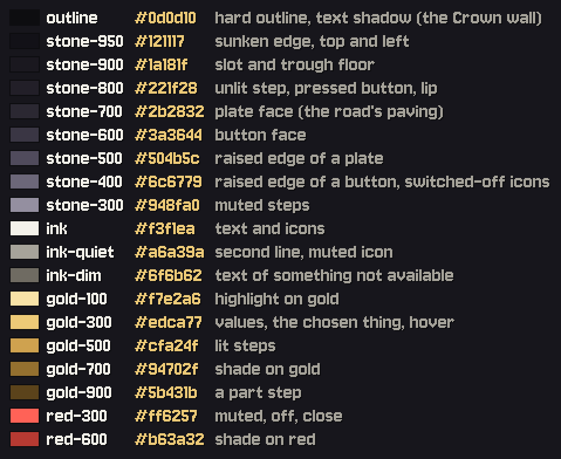
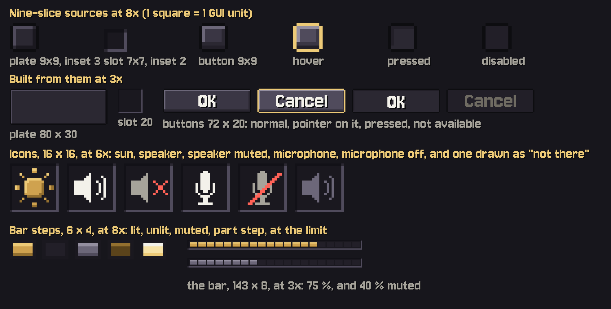
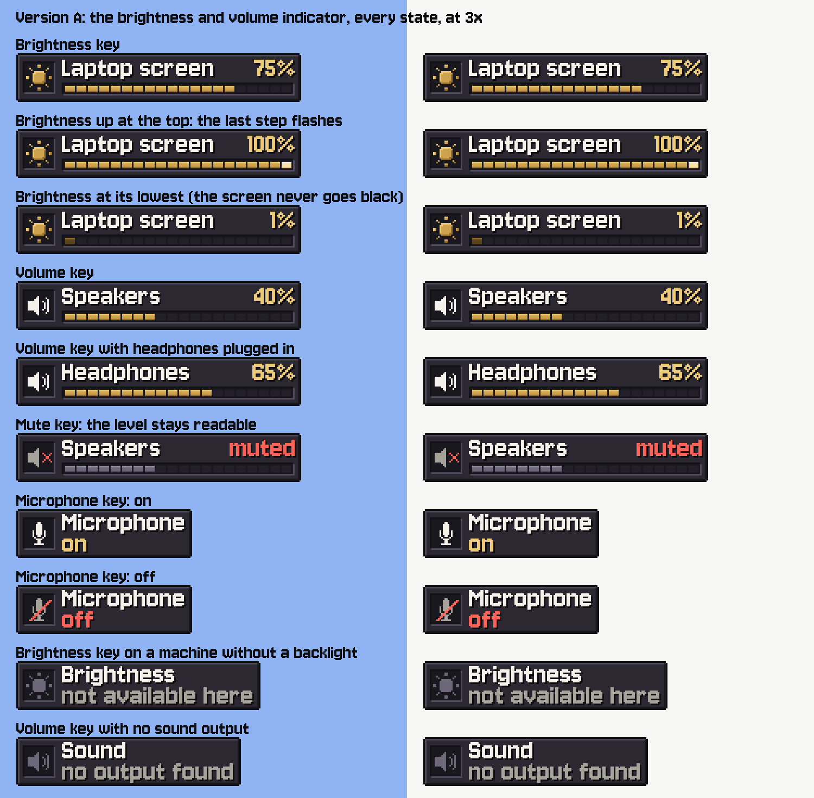
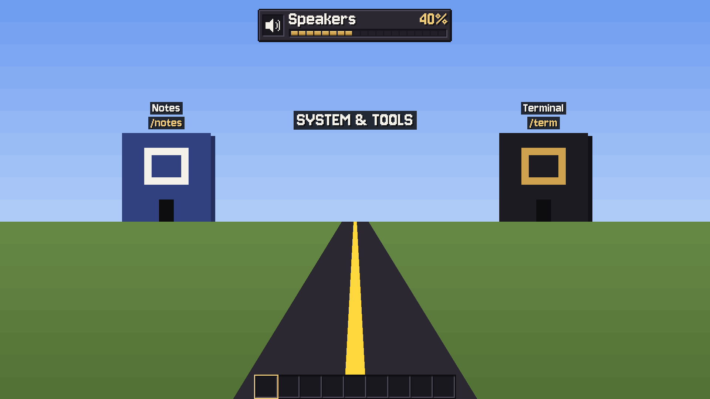
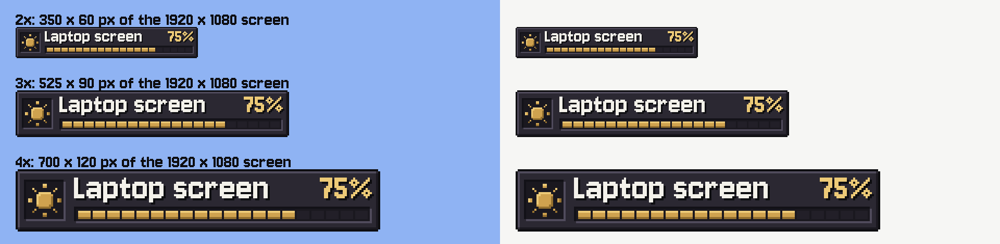

# The desktop's pieces: how they look and how they behave

**Status:** a design study in progress (package 312, `briefs/312-component-study.md`). Step 1 of 4 is written: the
theme layer, version A's colours and font, the grid, version B's runtime contract, and the brightness and volume
indicator. Sections marked *step 2*, *step 3* or *step 4* are still to come. Nothing here is built, and this study
changes no image, theme, `rc.xml` or mod file.

**What it is for.** One design for the normal desktop pieces of AresOS, so each can be built from it in its own
package: the brightness and volume indicator, the window frame and its buttons, minimize, window layouts, app
switching, an app overview, and the password window. The Minecraft look comes first; a look in the style of the Ares
apps comes later and is not designed here.

**Two looks, for the owner to choose between.**

- **Version A** is our own pixel art. It is in this repo: `docs/design/components/`.
- **Version B** is Minecraft's real textures and font, read at run time from the game that AresOS installs. The repo
  is public and nothing of Mojang's may be in it, so B is **described in words here and never shown**. Its pictures
  have IDs (`B-01`, `B-02`, …) and are kept privately by the lead (`linux-desktop`), who shows them to the owner.

**Words used below**

| Word | Meaning |
|---|---|
| Source pixel | One pixel of a sprite as it is drawn. |
| GUI unit | Minecraft's unit for its interface. One unit is one source pixel. A vanilla button is 200 by 20 units. |
| Scale | How many screen pixels one GUI unit takes: 2x, 3x, 4x. Always a whole number. |
| Screen pixel | One pixel of the laptop's 1920 by 1080 panel. |
| Passive piece | Shows something and never takes the keyboard or the mouse (an indicator, a hint). |
| Interactive piece | He chooses something in it (a layout picker, the overview). |
| Look | One set of colours, sprites and font for all pieces. A and B are two looks. |

Contents: [1 The theme layer](#1-the-theme-layer) · [2 Version A's colours and font](#2-version-as-colours-and-font) ·
[3 The grid and the scales](#3-the-grid-and-the-scales) · [4 The pieces](#4-the-pieces) ·
[5 Version B's runtime contract](#5-version-bs-runtime-contract) · [6 A against B](#6-a-against-b) ·
[7 Questions for the owner](#7-questions-for-the-owner) · [8 What the next hub session checks](#8-what-the-next-hub-session-checks)

---

## 1. The theme layer

**The rule.** Every piece has two halves that never mix:

- **Function:** what it shows, which keys and clicks it answers, where its parts sit relative to each other, which
  screen it is on, what it does with the keyboard. This is the piece's program.
- **Look:** colours, sprites, font, and the few sizes that follow from them (how high a capital letter is, how thick
  a plate's edge is). This is data in one place, the **look pack**.

A piece asks the look pack for parts by what they are for, never by what they look like: "the plate", "a lit step",
"the text colour for a value", never "dark grey" or "gold". Swapping the pack changes how every piece looks and
nothing about what it does. That is how A and B fit the same pieces today, and how the Ares-apps look can come later
without rebuilding them.

**Kept simple.** One look is active. There is no theme switcher, no setting, and no Ares-apps look in this study.

### The look pack

One folder, `/usr/share/aresos/look/` in the image (version A):

| In it | What |
|---|---|
| `look.json` | Colours by role (`ink`, `value`, `quiet`, `warn`, `outline`), sizes in GUI units (capital height, the gap between two lines, a plate's padding), and one entry per sprite: its file, its size, its nine-slice insets and its states. |
| `sprites/*.png` | Each sprite once, at one pixel per GUI unit. Programs enlarge them in whole steps. |
| The font | For A a normal font file installed in the image (section 2). For B the game's letter sheets (section 5). |

The study's own drawing code is built the same way, as a proof: `reviews/312-component-study/tools/look.py` has one
function that lays out the indicator and knows no colour or pixel, and it drew both A's public pictures and B's
private ones from two packs. The two looks even differ in their sizes (A's capitals are 10 units high, the game's
are 7), and the same layout code coped.

### Where the look lives for each kind of piece

| Kind of piece | Who draws it | Function lives in | Look lives in |
|---|---|---|---|
| Window frame: title bar, its buttons, border, labwc's menus, Alt+Tab, the snapping preview | labwc | labwc and `rc.xml` (button order, keys, mouse) | A labwc theme folder (`themerc` and one image per button and state), **generated from the look pack** by a script, as `reviews/window-design-v1/draw-buttons.py` generates Ares-Crown's today. Plus five kinds of line in `rc.xml` that labwc keeps outside the theme: the theme's name, the fonts, the corner radius, shadows on or off, the Alt+Tab style. |
| New pieces: the indicator, later a layout picker and the overview | A small layer-shell program each | That program | The look pack, read when the program starts. It copies sprites and letters onto its surface at a whole scale. |
| The mod's own screens | The game | The mod | The game's own widgets, as today (package 48 kept vanilla buttons on purpose). A's sprites sit on the game's grid (section 3), so the mod could ship them as its widget textures later; that is the owner's choice then, not part of these builds. |
| The password window's inside | Qt (`ksshaskpass`) | `ksshaskpass`, unchanged | A Qt style sheet, colours and font generated from the look pack (step 4; its build needs its own review on the owner tools' checked path). |
| Programs that draw their own bar (Chrome, GNOME apps, frameless Electron) | The program | The program | Not ours. Only the button-order setting reaches them (`docs/design/WINDOWS.md`). |

### What the separation costs

1. **One more thing to keep in step.** The pack is the source; labwc's theme folder and the Qt style sheet are
   generated from it. The image checks already pin Ares-Crown's checksum and file count; the same kind of check must
   show that the generated files match the pack.
2. **Layout from the pack's sizes.** A piece may not hard-code "the text is 10 units high". It asks. That is a little
   more code in every piece, and every piece must be looked at in each look it ships with.
3. **labwc keeps part of its look in `rc.xml`.** A change of look is the theme folder, those `rc.xml` lines and the
   image check's pin in one commit, and `rc.xml` changes go to `linux-aresos` first.
4. **A change of look needs a restart of the piece.** Programs read the pack when they start; labwc reads its theme
   at start or on `labwc --reconfigure`. Nothing changes while it is on screen. That is enough for one look.
5. **labwc cannot do everything a look may want** (no pressed button image, one border colour, soft shadows only;
   WINDOWS.md lists it). A look has to work within that for the frame. Step 2 says what that means for A and B.

What it does not cost: no switcher, no settings screen, no second look kept alive.

---

## 2. Version A's colours and font

### Where A starts from

Package 31's unshipped **Ares-Block** study (`docs/design/WINDOWS.md`) is the starting point. A keeps its
construction and changes its colours.

- **Kept:** everything on a pixel grid, a hard dark outline, square corners, raised plates and sunken slots made of
  one light and one dark edge, pixel glyphs, the pointer lighting a button, red for close, and the font Jersey 10.
- **Changed: the greys become dark stone and gold.** Ares-Block's flat light greys are the game's own inventory
  look redrawn by hand. Version B does that with the real thing, so a light grey A would only be a weaker B. And
  package 31 already found that a light game panel around Chrome or an editor "reads as a costume after a while".
  A instead takes the materials AresOS already has in its own world: the dark stone pad he stands on and the dark
  paving of the roads, the gold block under his feet, the dark plates his apps' names stand on. Those are also
  Ares-Crown's colours (near-black, off-white, one gold), so A's pieces sit next to today's window frame while the
  pieces arrive one by one.
- **Corrected: the font's size.** Ares-Block set Jersey 10 at 21 pt and noted that "a few letter edges still land on
  half pixels". The font's own grid explains it (below): 21 pt is one and a half times its drawn size. The sizes that
  land on whole pixels are 14, 28 and 42 pt.

### The colours

| Name | Colour | For | From |
|---|---|---|---|
| `outline` | `#0d0d10` | The one-unit outline of every plate and button; the text's hard shadow | Ares-Crown's wall |
| `stone-950` | `#121117` | The dark edge of a sunken slot | new |
| `stone-900` | `#1a181f` | The floor of a slot and of the bar's trough | new |
| `stone-800` | `#221f28` | An unlit step, a pressed button, a button's lower lip | new |
| `stone-700` | `#2b2832` | A plate's face | the road's paving in the laptop home's day look |
| `stone-600` | `#3a3644` | A button's face | new |
| `stone-500` | `#504b5c` | The light edge of a plate | new |
| `stone-400` | `#6c6779` | The light edge of a button; an icon of something that is not there | new |
| `stone-300` | `#948fa0` | Steps of a muted level | new |
| `ink` | `#f3f1ea` | Text and icons | Ares-Crown's ink |
| `ink-quiet` | `#a6a39a` | A second line; a muted icon | Ares-Crown's quiet ink |
| `ink-dim` | `#6f6b62` | Text on a button that cannot be used | the laptop home's quiet ink |
| `gold-100` | `#f7e2a6` | A highlight on gold | new |
| `gold-300` | `#edca77` | A value, the chosen thing, the pointer on a button | Ares-Crown's gold |
| `gold-500` | `#cfa24f` | Lit steps | the laptop home's gold |
| `gold-700` | `#94702f` | The shade on gold | new |
| `gold-900` | `#5b431b` | A part step | new |
| `red-300` | `#ff6257` | Muted, off, close | the Games group's colour (`AppGroup`) |
| `red-600` | `#b63a32` | The shade on red | new |

The "stone" steps are one cool, slightly violet grey in eight brightnesses, built outwards from the paving colour.
The other three group colours (`#3AB3DA`, `#C774F2`, `#FED83D`) stay what they are, the colours of app groups, and
are not used for the desktop's own parts.

**Rules for using them**

- Gold means lit, chosen or "this is the number". Red means off, muted or close. Nothing else is coloured.
- Text is `ink` with a hard shadow one unit down and one unit right, in `outline`. That is how the laptop home's day
  look already writes over the world.
- Sprites are flat: no gradients, no see-through pixels except the cut corners. labwc cannot blur, and flat sprites
  survive every whole scale.

### The font: Jersey 10

| | |
|---|---|
| File | `Jersey10-Regular.ttf`, 77,732 bytes (78 KB) |
| SHA-256 | `db9cbd091617048a145d249daa2b815fe7083be6ab66ac26626e21a4e01c3e82` (the same file WINDOWS.md recorded; downloaded again on 2026-11-19) |
| Official source | Google Fonts, `ofl/jersey10` in `github.com/google/fonts`; the project is `github.com/scfried/soft-type-jersey` |
| Licence | SIL Open Font License 1.1, © 2023 The Soft Type Project Authors. We may ship it with its licence text. |
| Designer | Sarah Cadigan-Fried |

**Its grid, measured.** The font has 1400 units per em and is drawn in squares of 75 units. In those squares a
capital is 10 high, a small letter 8, a descender 2, and a line is 20: exactly one widget row of 20 GUI units. So one
font square is one GUI unit, and:

| Scale | Font size that lands on whole pixels | Capitals | A line |
|---|---|---|---|
| 1x | 14 pt (18⅔ px em) | 10 px | 20 px |
| 2x | 28 pt | 20 px | 40 px |
| 3x | 42 pt | 30 px | 60 px |

labwc takes whole points only, and 14, 28 and 42 are whole. *Checked:* drawn with FreeType at 56 px (three pixels per
square), the test line had no grey pixel at all, and the letters in the pictures here are every third pixel of that
drawing. *Not checked yet:* labwc's and Qt's own text drawing at these sizes; the first build that
uses the font checks it in a private labwc.

**Letters it has.** Basic Latin, Western and Central European letters including `Ä Ö Ü ä ö ü ß ẞ` and `€` (the
font's character list as fontconfig reads it). It has no Greek or Cyrillic. Where a letter is missing, labwc and Qt
fall back to the system font by themselves; our own programs must draw text through the system's text library for the
same reason, not from a fixed letter table.

**Not derived from Minecraft's font.** It is one of a family of sports-shirt lettering in four sizes (Jersey 10, 15,
20, 25) with its own public source. It is built differently: capitals 10 squares high with strokes 2 squares wide,
where the game's letters are 7 high with strokes of 1. A private check compared the bitmaps letter by letter: of the
94 printable ASCII letters, none is the same in the two fonts.

**Its weak spot.** `0` and `O` look the same, and so do `1`, `l` and `I` (bottom of the picture). Among the sixteen
characters a fingerprint uses (`0`–`9`, `a`–`f`) I see no pair that can be confused, but that is the password
window's proof to make (step 4); its fallback is to set the eight characters in JetBrains Mono, which the R29 image
brings.

**The other candidate.** Pixelify Sans (OFL, SHA-256 `9ba86cd0…89e8a5` of the variable file from `ofl/pixelifysans`)
did not land on whole pixels at any size from 8 to 48 px in the same test, so its letters would always have soft
edges. Not looked at further. Silkscreen has no small letters. Fonts made to imitate the game's letters were not
considered at all.

**No font is committed by this study.** Shipping Jersey 10 is an image change for the first build package that needs
it: the file and its licence text in `/usr/share/fonts/aresos/`, the README's licence list, the font cache step
(`fc-cache --system-only --really-force`, see STATE.md's font-cache note) and the image checks.

---

## 3. The grid and the scales

**On the laptop's 1920 by 1080 panel**

| Scale | The screen in GUI units | A 20-unit row | A's capitals | The same in the game |
|---|---|---|---|---|
| 2x | 960 × 540 | 40 px | 20 px | GUI Scale 2 |
| 3x | 640 × 360 | 60 px | 30 px | GUI Scale 3 |
| 4x | 480 × 270 | 80 px | 40 px | GUI Scale 4, which is also what "Auto" gives at this resolution |

**Two scales, by what a piece belongs to** (a first proposal; steps 2 to 4 confirm it for their pieces):

- **2x for what is attached to a window:** the frame and its buttons. A 20-unit title bar is 40 px, close to
  Ares-Crown's 36 px. At 3x it would be 60 px, far too much of every window.
- **3x for what floats over everything:** the indicator. It is seen at a glance and from further away, and it sits
  near the game's own interface, whose pixels are 3 or 4 screen pixels wide.

Each mockup says its scale. `A-05` shows the indicator at 2x, 3x and 4x in real screen pixels.

**For the lead to confirm, not a question for the owner:** the GUI scale his game actually runs at. If it is 4, the
overlay scale may want to be 4 as well, so that the indicator's pixels match the hotbar's.

**Rules for every sprite**

- One PNG per sprite and state, one pixel per GUI unit. Sizes and insets are whole units.
- Enlarged only by whole factors, without smoothing. Text and parts are placed on whole units.
- Nine-slice: the corners are copied, the edges and the middle are **repeated**, never stretched (that is also what
  the game does with a nine-slice sprite, so the mod can use the same files).
- An outline is one unit. A button is 20 units high.

**Version A's sprites so far** (`docs/design/components/sprites/`, made by `tools/draw_a.py`):

| Sprite | Source size | Nine-slice insets | States | Used by |
|---|---|---|---|---|
| `plate` | 9 × 9 | 3 on every side | one | layer-shell programs; later the Qt style sheet and the mod |
| `slot` (also the bar's trough) | 7 × 7 | 2 on every side | one | the same |
| `button` | 9 × 9, built to 20 high | left 3, top 3, right 3, bottom 4 | normal, pointer on it (`-hover`), pressed, not available (`-disabled`) | the same. **A first pass:** step 2 owns the buttons and may redraw them. |
| `step-*` | 6 × 4 | none | lit, unlit, muted, part, limit | the indicator |
| `sun`, `speaker`, `speaker-muted`, `microphone`, `microphone-off` | 16 × 16 | none | each also drawn in one grey as "not there" | the indicator |

labwc's title-bar buttons are **not** these sprites: labwc wants one finished image per button and state at a fixed
size, knows no nine-slice and has no pressed state. Step 2 defines them and how they are generated from the pack.

---

## 4. The pieces

### 4.1 The brightness and volume indicator

*Passive. Complete in both looks.*

**What he sees.** He presses a brightness or volume key. A small plate appears at the top centre of the screen: an
icon, the name of the thing that is changing, its level as a number, and a bar of twenty steps. Each press moves the
bar by one step. A moment after the last press it is gone. He never has to click it, and it never takes the keyboard
or the mouse from what he is doing, in an app or in the world.

*Left over the world's sky colour, right over a white page. All values are made up.*

**Which keys show it, and what each does.** These are the six keys `rc.xml` binds today (lines 24 to 29). Only they
show it: a change made in a program's own volume slider does not.

| Key | What changes | What appears |
|---|---|---|
| Brightness up, down | The laptop panel's backlight by 5 %, never below 1 % (as today) | Sun, "Laptop screen", the number, the bar |
| Volume up | The sound output by 5 %, never above 100 % (as today). **New: it also ends mute**, as every phone and both big desktop systems do. | Speaker, the output's name, the number, the bar |
| Volume down | The sound output by 5 %. Mute stays as it is. | The same; while muted the bar moves in grey |
| Mute | Speaker mute on or off | Muted: a crossed speaker, "muted" in red, the bar in grey **at the level it will come back to**. Unmuted: the normal picture. |
| Microphone mute | Microphone on or off | A short plate without a bar: "Microphone" and "on", or a crossed microphone and "off" in red. There is no bar because no key changes the microphone's level. |

**The levels it shows**

- Twenty steps of 5 %, the keys' own step, so one press is one step.
- A level between two steps (a program set 62 %) lights the next step dimly. The lowest brightness, 1 %, shows as that
  dim first step: the screen is on, but there is nowhere lower to go.
- At 100 % a further press changes nothing, so the last step flashes bright for a moment. A key press is never
  silent.
- A volume above 100 % that a program set shows a full bar and the true number.

**The name says what is changing.** Not "Volume" but where the sound goes: "Speakers", "Headphones", "HDMI", or a
Bluetooth device's own name, cut to fit. Not "Brightness" but "Laptop screen", because with a monitor attached that
is the only screen these keys reach. If the output's kind cannot be found it says "Volume".

**Holding a key.** labwc repeats a held key's action (by default 25 times a second after 0.6 seconds), as it does
today. The bar runs with it and the plate stays for as long as the key is held. Whether that speed feels right is
something only trying it on the laptop shows; the build can drop repeats that come faster than a set rate if not.

**When it disappears.** 1.5 seconds after the last key event, at once and without a fade. Pressing another of the six
keys while it shows changes the plate in place and starts the 1.5 seconds again. There is only ever one.

**Which screen**

- **Volume and microphone:** the screen the pointer is on. In the world that is the world's screen, because the game
  holds the pointer there; in an app it is where he is working. It is also where package 23c opens apps.
- **Brightness:** always the laptop's own screen (the output whose name starts with `eDP`, as the laptop home finds
  it), also when the pointer is on the monitor. That is the screen that changes, and the name on the plate says so.
- With one screen, as today, all of this is the same screen.

**When there is nothing to control.** The key still answers, with a short plate and a greyed icon:

| Case | It says |
|---|---|
| No backlight device (a desktop PC, a VM) | "Brightness" / "not available here" |
| The laptop's screen is off (lid closed, monitor only) | "Laptop screen" / "is off", on the pointer's screen |
| No sound output | "Sound" / "no output found" |
| No microphone | "Microphone" / "none found" |

**Where on the screen: top centre.** Eight units below the top edge.

*1920 × 1080. The scene is a drawing of our own in the day colours of the laptop home; the row of slots at the bottom
stands for the game's hotbar and is version A's slot sprite, not the game's bar.*

- It is where the game itself shows a named bar (a boss's), so it reads as part of the world.
- It never meets the hotbar, the hearts above it, the chat line or the laptop home's hotbar and typing line, which
  all live at the bottom.
- It is in the same place over the world and over an app.
- Its cost: over a maximized app it covers the middle of the title bar and of whatever lies just under it, such as a
  browser's address bar, for those 1.5 seconds: [`A-08`](components/A-08-indicator-over-app.png).

The alternative is the bottom centre, above the hotbar and the hearts, where Windows 11 puts it:
[`A-07`](components/A-07-indicator-bottom.png). It is nearer to where his eyes are in the world, but it sits in the
middle of the view there and over a film's subtitles in an app. This is question 1 in section 7.

**How big.** 175 × 30 units. Shipped at 3x that is 525 × 90 px.

2x (350 × 60 px) is the size of a Windows flyout and easy to miss from a chair's distance; 4x (700 × 120 px) is right
only if his game's interface is also at 4. Question 2 in section 7.

**With the world**

- It is a layer-shell surface on the **overlay** layer, above every window including fullscreen ones, with keyboard
  mode "none" and an empty input region. So it cannot get the keyboard, clicks fall through it, and the game's hold
  on the pointer is not touched (package 40's focus rules).
- It is not a window. `aresos-shell` never sees it, it is not in Alt+Tab, and it can never count as covering the
  world.
- It binds no new key. Super stays free.

**Where we lean on Windows, and what is our own**

| Like Windows | Our own |
|---|---|
| A small plate that the keys bring up and that leaves by itself | It names the device, so he sees where the sound goes and which screen dims |
| A bar and a number | Twenty steps that match the keys: he can count presses |
| A crossed icon for mute | Muted keeps the level readable, in grey, so he knows what unmuting brings back |
| | The limit flashes and a missing device answers: no key press is ever silent |
| | It sits where the world shows its own bars, not where a taskbar would be |

**Version B: `B-01` to `B-06`** (private pictures; `B-03` is the sheet with A and B side by side).

- **`B-01`, the same layout in the game's art.** The plate is the game's "now playing" toast, a dark rounded panel.
  The level is the game's boss bar in yellow with its 20-notch overlay, white when muted. Text is the game's font,
  white with yellow numbers and its usual shadow. Icons are game items, because the game has no sun, loudspeaker or
  microphone picture at icon size (its sun is a 32 × 32 sky texture on black): a lantern for brightness, a bell for
  volume, the bell under the barrier sign for muted, and the two chat-bubble buttons of the social screen for the
  microphone. It is 217 × 32 units, 651 × 96 px at 3x: wider than A, because the game's bar is 182 units long and
  cannot be shortened without redrawing it.
- **`B-02`, the game's own control.** Each state as the options screen's slider, 200 × 20 units, with the text
  inside it ("Laptop screen: 75%"), and the microphone and the missing-device cases as a plain game button. No
  plate, no icon. It is the most Minecraft of all the forms and needs no stand-in icons, but a slider looks like
  something to drag, and this one cannot be dragged.
- **`B-04`, `B-05`, `B-06`:** B at the top centre over the same drawn scene and over the app, and at 2x, 3x and 4x.

**What he would notice between A and B on this piece**

- **The letters.** At the same scale A's are larger and heavier (capitals 10 units, strokes 2) and the game's are
  smaller and thin (7 and 1). At 3x that is 30 px against 21 px. A reads from further away; B is unmistakably the
  game.
- **The icons.** A has a sun, a speaker and a microphone. B has a lantern, a bell and chat bubbles, which have to be
  learned.
- **The plate.** A's is AresOS's dark stone with a gold bar and matches today's window frame. B's is the game's
  toast and matches the mod's own screens.
- **The steps.** A's twenty steps are even and separate. The game's bar is one strip of 182 units with a 20-notch
  overlay, and twenty does not divide 182 evenly.

**What it is built from**

| | |
|---|---|
| Draws it | One small layer-shell program, called `aresos-indicator` here. Not the mod: it has to show over apps too, and one program for both cases is simpler than two. |
| Existing things it uses | gtk4-layer-shell, GTK and Cairo, which the R29 image brings for the laptop home; `brightnessctl` and `wpctl`, already in the image; the look pack. |
| New: the keys' command | The six `rc.xml` lines call one small script (`/usr/libexec/aresos-level <action>`) instead of `brightnessctl` and `wpctl` directly. It makes the change first, with the same commands, steps and limits as today, then tells the indicator the new state. **If the indicator is broken or missing, the keys still work.** It is also the one place that holds the step size and the "volume up ends mute" rule. |
| New: the program | Started by the first key press, stays while it is used, ends after a minute without one, so it costs no memory at rest (a GTK program is about 50 MiB while it runs, by the laptop home's measurement). GLib's own single-instance start through the session bus does this without code of ours, if the session has a bus; otherwise the script starts it. The builder checks which. |
| `rc.xml` | Six changed lines. They go to `linux-aresos` first, and the image checks that know today's lines move in the same commit. |
| Size | One small package: the script (about 40 lines), the program (about 300), the look pack's first files, the image and its checks, and tests in a private labwc. One or two builder steps. In look A only; B adds section 5's shared work first. |

**What the build must test** (in a private headless labwc, as packages 31 and 23c test):

- The world keeps the pointer and the keyboard while the plate appears, changes and disappears (a test client that
  holds a pointer lock and counts its key events).
- A click at the plate's position reaches the window below it.
- It shows above a fullscreen window.
- With the indicator's program removed, each key still changes its level.
- A held key: the bar follows without piling up work, and the plate leaves 1.5 seconds after release.
- Each "nothing to control" case, with the device taken away.
- Two outputs: brightness on the `eDP` one, volume on the pointer's.

**Decisions taken here, with reasons** (all can change later without redesign)

| Decision | Why |
|---|---|
| The keys show it; other changes do not | He asked for an answer to the keys. A plate that pops up when a program moves its own slider is noise. |
| The key's command changes the level itself and only then tells the indicator | The keys must never depend on a program that draws. |
| Volume up ends mute; volume down does not | He pressed "louder". Every phone and both desktop systems do it. |
| The microphone has no bar | No key changes its level, and a bar would say one does. |
| Gone at once after 1.5 s, no fade | The pixel look has no soft motion, and a fade means drawing sixty times a second for nothing. |
| A layer-shell program started on first use | It must show over apps; a resident program would hold about 50 MiB for something used a few times a day. |
| The name of the device, not "Volume" | It answers the question he would otherwise have to open a settings window for. |

**Not verified** (nothing was run; these come from labwc's and the protocol's documented behaviour and must be
confirmed by the build's tests): that labwc puts a layer surface without a named output on the pointer's screen;
that a surface with an empty input region never disturbs a pointer lock; the repeat rate; whether the session has a
bus that can start the program.

### 4.2 The window frame and its buttons

*Step 2:* the buttons and the frame in A and B with their states, minimize and restore, what labwc can draw and what
programs draw themselves.

### 4.3 Window layouts and split screen

*Step 3:* layouts from the top of the window, the covering rule and its cases.

### 4.4 App switching

*Step 3.*

### 4.5 The app overview

*Step 4.*

### 4.6 The password window

*Step 4.* Step 1 leaves it one finding: Jersey 10's `0`/`O` and `1`/`l`/`I` look alike (section 2), and the full
label "AresOS owner tools dcbc375f: install these tools, then check and title" is about 450 units wide in Jersey 10,
which is about 900 px at 2x and 1350 px at 3x.

---

## 5. Version B's runtime contract

B uses the game's own files, on the laptop, from the game that AresOS installs. Nothing of the game is in the repo
or in the image, before or after.

### Where the files are

B never searches the disk. It starts from the managed instance and follows what the instance itself names:

1. **The instance:** `~/.local/share/PrismLauncher/instances/AresDesktop/`, the folder `aresos-desktop` creates and
   checks (`os/config/usr/libexec/aresos-desktop`; the name comes from `os/minecraft/desktop.lock.json`).
2. **What it pins:** the instance's `patches/net.minecraft.json`. That file comes from the image and is pinned by
   SHA-256 in the lock file. For 26.2 it names the main jar `com.mojang:minecraft:26.2:client` with its SHA-1 and
   size (39,193,383 bytes), and the asset index `32` with its SHA-1.
3. **The client jar:** Prism keeps libraries by their coordinates, so the jar is
   `~/.local/share/PrismLauncher/libraries/com/mojang/minecraft/26.2/minecraft-26.2-client.jar`. B checks its size
   and SHA-1 against step 2 before reading it. A jar that does not match is treated as missing.
4. **The asset objects:** `~/.local/share/PrismLauncher/assets/indexes/32.json` lists every object, and each is at
   `assets/objects/<first two characters of its SHA-1>/<SHA-1>`.

*Not verified:* the two Prism paths are Prism's known layout and were not seen on a real `AresDesktop`, because this
laptop has no such instance yet. The first build that uses B confirms them. The study's own B pictures were made
from the mod's development copy of the same jar (the same size as step 2 names).

### What B reads

**Inside the jar** (everything under `assets/minecraft/`):

| For | Paths |
|---|---|
| Letters | `font/include/default.json` (which sheet holds which letter) and `font/include/space.json`; the sheets `textures/font/ascii.png`, `accented.png`, `nonlatin_european.png` |
| The indicator | `textures/gui/sprites/toast/now_playing.png`; `boss_bar/yellow_background.png`, `yellow_progress.png`, `white_background.png`, `white_progress.png`, `notched_20_background.png`, `notched_20_progress.png`; `textures/item/lantern.png`, `bell.png`, `barrier.png`; `gui/sprites/social_interactions/mute_button.png`, `unmute_button.png`. For the slider form: `gui/sprites/widget/slider.png`, `slider_handle.png`, `button.png`, `button_disabled.png` |
| Nine-slice insets | The `.png.mcmeta` file beside a sprite, which is where the game itself keeps them (for example the toast's border of 4, a button's of 3) |
| Later pieces | Steps 2 to 4 add their lists here. |

**From the asset objects: nothing.** The sounds, the translations and the game's large fallback font
(`minecraft/font/unifont.zip`) live there. B reads none of them.

**The map.** Which game file fills which part of which piece is a small table that ships in the image beside A's
pack (`look-b.map.json`: part, path in the jar, the size it must have, the game versions it was checked against).
It contains names and numbers only.

### When it copies, and how it notices a game update

- **When:** once per session start, after `aresos-desktop` has found the instance whole, a small step (called
  `aresos-look-b sync` here) runs as him, in the background. The desktop never waits for it, and it is no part of
  readiness.
- **Where to:** `~/.cache/aresos/look-b/`, readable by him only. It copies only the files the map names, checks each
  (it opens as a PNG, it has the size the map says), and writes a stamp: the jar's SHA-1 and the map's version. The
  new copy is built in a hidden folder and renamed into place, so pieces see a whole cache or none.
- **Nothing to do:** if the stamp matches the jar and the map, the step ends at once.
- **The first start:** Prism downloads the game only after he has signed in, so on the very first session there is
  no jar and every piece is A. The next session start has B. A piece reads its look when it starts, so nothing
  changes while it is on screen.
- **A game update:** the image pins the game's version, so the game changes only with a new image. A new version
  means a new jar SHA-1, the stamp no longer matches, and the cache is rebuilt; the old one is deleted after the
  new one is in place.
- **A file that moved, disappeared or changed size:** the piece that needs it is drawn in A, **as a whole piece**.
  A piece is never half A and half B. The step records which pieces fell back, in the journal and in the stamp, so
  a status command can say "look B: 2 pieces on A".
- **Before a release with a new game version:** the map can be checked against that version without committing
  anything, in the mod's workflow, which already has the game through the build tool. A missing or resized file
  then fails that check instead of surprising him.

### Which program draws what, and how each would use B

| Program | Pieces | B's textures | B's font |
|---|---|---|---|
| Layer-shell programs | The indicator; later the layout picker and the overview | They read the cache instead of A's pack: the same parts by the same names. Nine-slice by the game's own insets. | They copy letters out of the three sheets using the game's table: a letter is as wide as its rightmost inked column plus one, a space is 4, the shadow is the colour at a quarter one unit down and right. Easy, and exact. |
| The mod | Its own screens | It is B already: it draws with the running game's widgets. | The game's own. |
| labwc | The frame, its buttons, menus, Alt+Tab | The sync step writes a **whole labwc theme folder** with the same name into `~/.local/share/themes/`, its button images put together from game sprites at the shipped scale. labwc looks in his home before the image, so B's folder wins while it exists and A's returns when it is gone, with no `rc.xml` change. The folder must be complete (labwc fills a missing image with its own grey default, not with A's), and labwc must be told to reload once after the first sync. *To verify in a private labwc.* | **labwc cannot read the game's font.** The game's font is letter sheets in the jar, and labwc can only use an installed font by name. Two ways: (a) under B the title bars keep A's Jersey 10; or (b) the sync step builds a real font file from the sheets into `~/.local/share/fonts/`, which needs a font-building library in the image and its own review. I would start with (a). |
| Qt (`ksshaskpass`) | The password window's inside | A style sheet whose border images point into the cache. | The same limit and the same two ways as labwc. |

**Letters the game's font has.** Its three sheets cover basic Latin (`ascii.png`), accented Latin including
`ä ö ü Ä Ö Ü` (`accented.png`) and `ß`, `ẞ`, `€`, Greek and Cyrillic (`nonlatin_european.png`). German is complete.
For anything else the game itself falls back to Unifont from the asset objects; B does not, and draws such a letter
in the system font.

### What it never touches

- At run time B opens only the files named above, under `~/.local/share/PrismLauncher/`, **read-only**, and writes
  only to its cache and, for labwc, its own theme folder (marked as its own, so it never overwrites a folder it did
  not make).
- It never reads `~/.minecraft`, `~/.lunarclient` or any other launcher's folder, also not as a fallback (hard
  rule 3). No instance, or an instance that fails its check, means A.
- The cache is never copied into the repo, an image, a backup or a report.

### B needs the game, and what that means if AresOS is ever shared

- B exists only on a machine whose owner has the game installed through their own account. The AresOS image holds no
  file of Mojang's, so it can be given to someone as it is. Without the game they see A everywhere; with their own
  copy they get B from it.
- **Everything public is A.** The repo, its README pictures, a website: any picture of AresOS's own pieces that is
  published has to be A, because a B picture is made of Mojang's pixels. So A must be good enough to be AresOS's
  face, whichever look he uses himself.
- Using a game's textures on one's own machine from one's own copy is what resource packs and mods do, and nothing
  is redistributed. That is my reading, not legal advice.

---

## 6. A against B

*Step 4 writes this: what he would notice, what each costs to build and keep, the risks, and a recommendation.*

What step 1 found, for step 4 to weigh:

- On the indicator the difference is mostly the letters and the icons (section 4.1).
- B needs work that A does not, before its first piece: the sync step, the map, the check per game version, and
  letter-copying in each of our programs.
- B does not reach every renderer equally: complete in our own programs and in the mod, but labwc's title bars and
  the password window cannot use the game's font without building a font file on his machine.
- A has to exist and be good either way: it is the fallback, and the only look that may be shown in public.
- B's private pictures so far: `B-01` to `B-06`.

---

## 7. Questions for the owner

*Step 4 makes the final list. The lead posts them. From step 1:*

1. **Where should the brightness and volume plate appear: at the top centre, or low above the hotbar?** Look at
   `A-06` (top) and `A-07` (low), and `A-08` for the top over an app. *Recommended: top centre.*
2. **How big should it be: small, medium or large?** Look at `A-05` (and `B-06`). *Recommended: medium (3x).*

For step 4's A-or-B question, the indicator's pictures are `A-04` against `B-01` and `B-02`, side by side in `B-03`.
If he chooses B, `B-01` (plate and bar) or `B-02` (the game's slider) is one more choice; I recommend `B-01`.

---

## 8. What the next hub session checks

*Answers so far, from step 1. Step 4 completes the list.*

| Check | Answer |
|---|---|
| No Mojang texture or font in any committed file, the pull request or the image | The committed pictures are made by `reviews/312-component-study/tools/draw_a.py` from three things only: flat colours, the letter maps typed into `look.py`, and Jersey 10. B's pictures are written by `draw_b.py` to one fixed folder outside the checkout, and that script has no option to write anywhere else. The staged files were checked before each push (`reviews/312-component-study/PROGRESS.md`). The study changes no image file. |
| A's art is not traced from the game's | Every A sprite is a small map of letters typed by hand in `look.py`; none was made by opening, copying or redrawing a game file. The game's sprites were looked at in the same step, for B's pictures, and A's differ from them in shape, size and colour: a square bevelled plate against the game's rounded toast, twenty separate gold steps against a continuous notched bar, a sun, speaker and microphone the game does not have. Jersey 10 shares no letter bitmap with the game's font (section 2). |
| Sprites sit on the GUI grid, so the mod can adopt them | One pixel per GUI unit, whole-unit insets, repeated edges, buttons 20 units high (section 3). |
| It sits next to the noon world and the laptop home's day street | `A-06` and `A-07` show it on a drawn scene in the day colours. A's dark plate is the same family as the world's name plates and the day look's dark bars. *Still to do by eye:* the real game behind it on the laptop. |
| Readable at 1920 × 1080 and at the stated scales | `A-04` (over sky and over white), `A-05` (2x, 3x, 4x), `A-08` (over an app). |
| The password window shows its full label and "Enter SSH Credentials" | *Step 4.* |
| Passive surfaces never take keyboard focus; interactive ones say who owns input | The indicator: overlay layer, keyboard mode "none", empty input region (section 4.1), with tests named for the build. Interactive pieces: *steps 3 and 4.* |
| Super stays free for the search over the world | The indicator binds no key. *Steps 2 to 4 for their keys.* |
