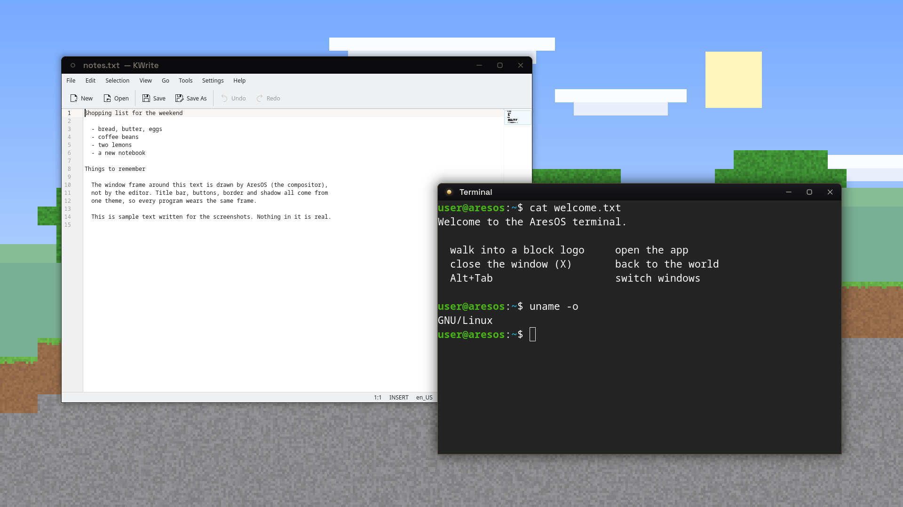
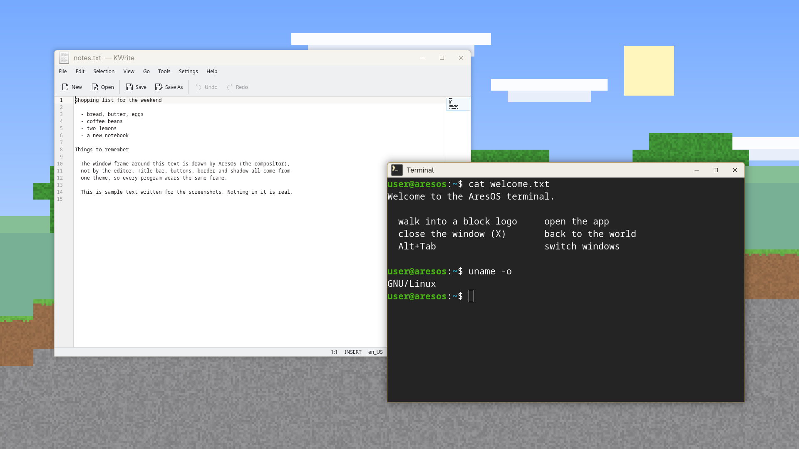
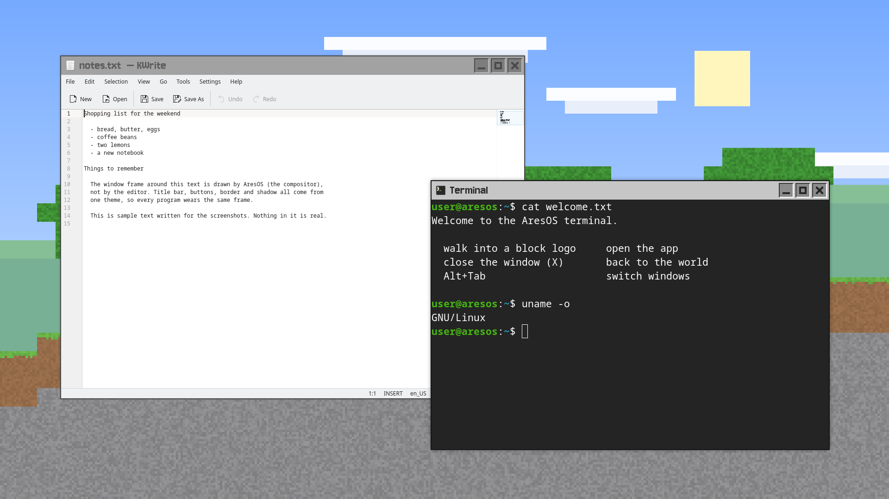
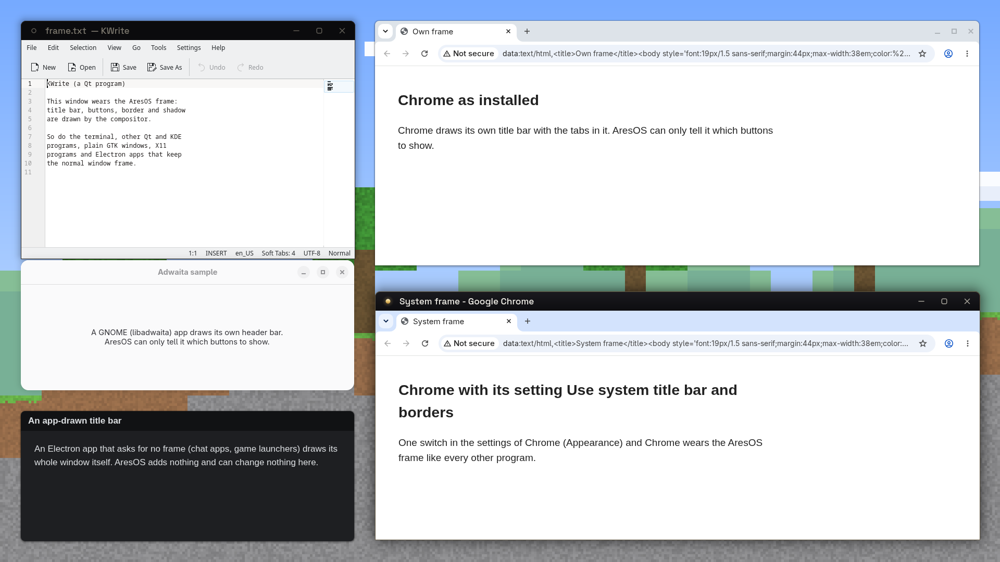

# App windows: the frame around every program

**Status:** proposal v1, 2026-11-13, branch `design/windows-v1`. Three working themes for the owner to choose from.
Nothing is switched on: `rc.xml` still names labwc's grey default, and no font was added to the image.

The owner (2026-11-13): "The app windows I dont really have a design for yet. The ares apps have a design style but
its more for apps. I dont know if its copiable onto app windows. [...] you can build custom window designs that fit
ares apps / aresos or just build them like windows as a default."

Short answer: yes, the Ares style carries onto a window frame, with a few things left out that the compositor cannot
draw. All three themes below keep what he knows from Windows: the title at the left of the bar, minimize, maximize and
close at the right in that order, and X closes the window and puts him back in the world.

## Today


A 26-pixel grey bar with tiny buttons. The active and the inactive window look almost the same.

## The three themes

Each picture is a real screenshot at the laptop's 1920x1080: an inactive window (the editor) and the active one (the
terminal) over a bright scene. The scene is a drawing made for these tests, not the game.

### Ares-Crown: the Empire's look on a frame



The crown language (`ares-empire/EMPIRE.md`) says: near-black wall, off-white text, polished gold as the one sparing
accent, glass. On a frame that becomes:

- **The wall:** a near-black title bar (36 px) with a faint sheen on the active window, flat on the others.
- **The one gold accent:** the gold dot at the left of the active window, taken from the hub's own mark
  (`.emp-mark-dot`). Inactive windows show an empty ring. A click on it opens the window menu, like the icon in the
  corner of a Windows title bar.
- **Text:** the title in Space Grotesk Medium, off-white, 17 px; dimmed on inactive windows.
- **Buttons:** thin rounded glyphs. Under the pointer a button lights up as a glass pill with a gold tint, as the hub's
  buttons do; close lights up red, as the hub's logout does.
- **Edge:** a 1 px warm line all round, top corners rounded by 10 px, a deep soft shadow.
- **Alt+Tab:** a dark panel with a preview picture of each window; the chosen one has a gold outline.

Needs: the font Space Grotesk in the image (see "What the image would add"). Without it labwc uses the system's
default sans font and the theme still looks right (tried).

### Ares-Plain: like Windows, but ours



The frame a Windows user already knows, in the Empire's day colours (the "marble hall" of the iPhone apps' light mode:
ivory wall `#EFEDE6`, near-black ink `#1A1813`, antique gold).

- The app's icon and the title at the left, three wide flat buttons at the right (46x36 px each).
- Under the pointer a button's whole box fills in, up to the window's corner; close turns red with a white X.
- A 1 px antique-gold line marks the active window; the others get a quiet grey line and grey text.
- Title in Adwaita Sans, 16 px. Top corners rounded by 8 px.
- Alt+Tab: a light panel with preview pictures.

Needs: nothing. Every font and icon it uses is already in the image.

### Ares-Block: a frame from the block world



A flat grey panel with a hard dark outline and square corners. The buttons are sunken slots with pixel glyphs in them;
under the pointer a slot lights up, close turns red. Everything sits on a grid of 2x2 screen pixels: the 2 px outline,
the 40 px bar, the 32 px slots, the glyphs. The title is set in the pixel font Jersey 10 at twice its drawn size.
Alt+Tab is a list like the game's own lists: the chosen row has a white outline.

Drawn from scratch from rectangles and flat greys: no texture, font, sound or image of the game is used or copied, and
Jersey 10 is a sports-lettering pixel font, not a copy of the game's font.

Needs: the font Jersey 10 in the image (see "What the image would add"). Do not switch this theme on before the font
is there: the fallback font at this size is much too large and makes the bar taller.

### More pictures

- [All three over a dark scene](../../reviews/window-design-v1/04-dark-scene.png) (the hub's home is the Nether, so
  the scene behind a window will often be dark red, not daylight).
- [Buttons close up](../../reviews/window-design-v1/05-buttons.png): active, pointer on minimize, pointer on close,
  maximized, inactive.
- [Window menu and Alt+Tab](../../reviews/window-design-v1/06-menus-switcher.png) in each theme.

## Recommendation: Ares-Crown

1. **It is ours.** AresOS belongs to the Empire, and this is the Empire's look reduced to what a frame needs: wall,
   text, one gold point. Nothing on it is decoration.
2. **It recedes.** A black bar lets the program be the content. With the terminal it forms one dark surface; on a light
   program it is a clear dark band.
3. **It holds on both scenes.** Over daylight the shadow and the black bar carry it; over the dark red of the Nether the
   warm edge line does, and black and gold on dark red is the Ares picture anyway.
4. **The active window is obvious** without colour noise: gold dot and bright title against an empty ring and a dim
   title.
5. **It still behaves like Windows.** Same places, same order, X closes.

Its cost is one font file of 137 KB, which the Empire's websites and iPhone apps already ship.

Ares-Plain is the safe second: no cost at all, and it sits closest to programs that draw their own light title bar
(Chrome, GNOME apps). Choose it if a light frame feels more like home.

Ares-Block is the most playful and the closest to the world behind the windows. I would not make it the default: a
pixel title is harder to read for long file names, and a game panel around Chrome or an editor reads as a costume
after a while. It is finished and can be switched on whenever he wants it.

## What every theme covers

| Part | State |
|---|---|
| Title bar, title text, border, shadow | active and inactive window |
| Minimize, maximize, restore (maximized), close | normal and under the pointer, for active and inactive windows |
| Window-menu button, roll-up and all-workspaces buttons | drawn too, so a later change of the button layout never shows a grey default |
| Maximized window | square corners, no border, the restore glyph |
| Menus (window menu, root menu) | background, text, highlighted row, separator, title, border |
| Alt+Tab | both of labwc's styles (pictures and list), the chosen entry, the outline around the window about to be picked |
| On-screen notes | workspace note, move and resize note |
| Snapping | the preview where a dragged window will land |

Every row was looked at in a screenshot, except the root menu, which uses the same settings as the window menu.

Each theme is a `themerc` and 36 SVG button images under `os/config/usr/share/themes/<Name>/labwc/`. The images are
the output of `reviews/window-design-v1/draw-buttons.py`: change a colour or a glyph there and run it again, so all 36
stay in step.

**How it was tested.** In a separate labwc 0.9.6 that draws to memory only (wlroots' headless backend, 1920x1080), with
its own runtime folder, D-Bus, home folder and font folder, never on the owner's screen. Windows: `foot`, `kwrite`,
Chrome with throwaway profiles, small GTK3, GTK4 and libadwaita sample windows, `glxgears` (X11), and a two-window
Electron 44.9.0 test app. A small script moved a virtual pointer and pressed virtual keys (hover, right-click, Alt+Tab,
workspace switch, dragging), and `grim` took the pictures. labwc's verbose log shows no complaint about any theme.

## What labwc 0.9.6 cannot do

Things I wanted and what stands in their place:

| Wanted | labwc | In the themes |
|---|---|---|
| Glass: a blurred, see-through bar (crown language) | no blur | a solid near-black bar with a faint top-to-bottom sheen |
| Gold gradient text, capitals, wide letter-spacing for the title | one flat colour, no text effects | off-white title; the gold moved into the dot |
| A bright gradient edge | one colour and one width for the whole border | a 1 px warm line |
| All four corners rounded | only the top corners | square bottom corners |
| A pressed look for buttons | normal and hover images only | none |
| A raised edge on the frame for Ares-Block (light top and left, dark bottom and right) | the border is one colour | a plain 2 px outline; the raised and sunken edges live in the buttons |
| A hard pixel shadow for Ares-Block | soft shadows only | a short soft shadow |
| A small app icon next to wide buttons (Ares-Plain) | the icon's size follows the button box | a larger icon than Windows shows |
| Space before the title without a button at the left | the title starts flush at the edge | every layout keeps one button at the left (dot or icon) |
| Any font size | whole points only (`20.25` is read as 20) | Jersey 10 at 21 pt = 28 px, its exact double size. A few letter edges still land on half pixels, because the font's own spacing uses quarter steps |
| The whole look in the theme folder | corner radius, fonts, shadows on or off, button order and Alt+Tab style are `rc.xml` settings | the lines below must change together with the theme's name |

Two notes on labwc's manual: it says font sizes are pixels, but they are points (13 gives 17 px text, 21 gives 28 px).
And a hover image is clipped to the rounded corner by labwc itself, so Ares-Plain's red close button follows the
corner without extra work.

## Programs that draw their own frame

The theme only reaches programs that let the compositor draw their frame. Tried on this machine:

| Program | Wears the AresOS frame? | What can be done |
|---|---|---|
| Terminal (`foot`) | yes | |
| Notepad (`kwrite`) and other Qt/KDE programs | yes | |
| Plain GTK3 and GTK4 windows | yes | |
| X11 programs through Xwayland (`glxgears`) | yes | |
| Chrome 157, as installed | **no**: its own bar with the tabs in it, and only a close button | see below |
| Chrome with "Use system title bar and borders" | yes | one switch in Chrome's settings |
| Chrome app windows (`--app=`) | yes | |
| Electron 44 app with the normal frame | yes | |
| Electron 44 app without a frame (chat apps, game launchers) | **no**: draws its whole window | nothing |
| GNOME apps (libadwaita) and GTK apps with a header bar | **no**: own header bar, only a close button | the button setting below |



(Ares-Crown, with the button setting below applied. The editor and the lower Chrome wear the AresOS frame; the upper
Chrome, the GNOME sample and the frameless Electron sample draw their own.)

**One setting gives them all three buttons.** Chrome and GNOME apps show only a close button because GNOME's default
for `org.gnome.desktop.wm.preferences button-layout` is `appmenu:close`. Set to `appmenu:minimize,maximize,close`,
Chrome's own bar and every header bar show minimize, maximize and close at the right, in our order. Tried with
`gsettings set` in the test session; the image would ship it as a default (see "What the image would add").

**Chrome: two honest options.**

- *Leave Chrome's own bar* (my advice). With the button setting it looks like Chrome on Windows: tabs on top, three
  buttons at the right. It costs no screen height and is what he knows.
- *Switch on "Use system title bar and borders"* (Chrome's settings, Appearance). Chrome then wears the AresOS frame
  like every other program, at the cost of 36 px of height. I found no Chrome policy for this switch (none among the
  policy names in Chrome's program file). It is the profile preference `browser.custom_chrome_frame` (`false` =
  system title bar); tried by writing it into a fresh throwaway profile.

A labwc window rule (`serverDecoration="yes"`) is **not** a way: labwc then draws its frame, and Chrome keeps its own
close button in the tab bar, so the window has two.

**Frameless Electron apps** (the Lunar Client launcher is Electron 44.9.0; Discord is the same kind) draw their title
bar, corners and shadow themselves. A window rule would only put a second bar on top. Nothing to do, and nothing
needed: they are dark, and next to Ares-Crown they look at home.

**Which theme sits best next to these?** Ares-Plain is closest to Chrome's and GNOME's light bars. Ares-Crown is
closest to dark apps such as the terminal and frameless launchers, and next to it Chrome simply looks like Chrome.
Ares-Block is the furthest from all of them.

## Switching a theme on

Not done here: another session is changing `rc.xml`'s key bindings this week. These lines replace the present
`<theme><name>Default</name></theme>`. They are exactly the lines each theme's pictures were taken with.

**Ares-Crown**

```xml
  <theme>
    <name>Ares-Crown</name>
    <icon>breeze</icon>
    <fallbackAppIcon>application-x-executable</fallbackAppIcon>
    <cornerRadius>10</cornerRadius>
    <dropShadows>yes</dropShadows>
    <titlebar><layout>menu:iconify,max,close</layout></titlebar>
    <font place="ActiveWindow"><name>Space Grotesk</name><size>13</size><weight>medium</weight></font>
    <font place="InactiveWindow"><name>Space Grotesk</name><size>13</size><weight>medium</weight></font>
    <font place="MenuHeader"><name>Space Grotesk</name><size>12</size><weight>bold</weight></font>
    <font place="MenuItem"><name>Space Grotesk</name><size>12</size></font>
    <font place="OnScreenDisplay"><name>Space Grotesk</name><size>13</size><weight>medium</weight></font>
  </theme>
  <windowSwitcher><osd style="thumbnail" /></windowSwitcher>
```

**Ares-Plain**

```xml
  <theme>
    <name>Ares-Plain</name>
    <icon>breeze</icon>
    <fallbackAppIcon>application-x-executable</fallbackAppIcon>
    <cornerRadius>8</cornerRadius>
    <dropShadows>yes</dropShadows>
    <titlebar><layout>icon:iconify,max,close</layout></titlebar>
    <font place="ActiveWindow"><name>Adwaita Sans</name><size>12</size></font>
    <font place="InactiveWindow"><name>Adwaita Sans</name><size>12</size></font>
    <font place="MenuHeader"><name>Adwaita Sans</name><size>10</size><weight>semibold</weight></font>
    <font place="MenuItem"><name>Adwaita Sans</name><size>12</size></font>
    <font place="OnScreenDisplay"><name>Adwaita Sans</name><size>12</size></font>
  </theme>
  <windowSwitcher><osd style="thumbnail" /></windowSwitcher>
```

**Ares-Block**

```xml
  <theme>
    <name>Ares-Block</name>
    <icon>breeze</icon>
    <fallbackAppIcon>application-x-executable</fallbackAppIcon>
    <cornerRadius>0</cornerRadius>
    <dropShadows>yes</dropShadows>
    <titlebar><layout>icon:iconify,max,close</layout></titlebar>
    <font place="ActiveWindow"><name>Jersey 10</name><size>21</size></font>
    <font place="InactiveWindow"><name>Jersey 10</name><size>21</size></font>
    <font place="MenuHeader"><name>Jersey 10</name><size>21</size></font>
    <font place="MenuItem"><name>Jersey 10</name><size>21</size></font>
    <font place="OnScreenDisplay"><name>Jersey 10</name><size>21</size></font>
  </theme>
  <windowSwitcher><osd style="classic" /></windowSwitcher>
```

What the lines do:

- `<icon>` names the icon set for app icons in the title bar and in Alt+Tab. Without it labwc looks for an icon set
  named like the theme, and there is none.
- `<fallbackAppIcon>`: the terminal opened from the hub has the app id `aresos.terminal`, which has no desktop entry,
  so it has no icon; labwc's own fallback icon is not in the image. With this line such windows get a generic program
  icon instead of an empty space. A desktop entry `aresos.terminal.desktop` with a terminal icon would be the better
  fix; it is left out here because another session is building the program listing in `aresos-shell`, and a new
  desktop entry could show up in it.
- `<cornerRadius>`, `<dropShadows>`, `<font>` and `<windowSwitcher>` belong to the theme's look but are `rc.xml`
  settings in labwc.
- Sizes are whole points: 12 = 16 px, 13 = 17 px, 21 = 28 px.

Dragging the bar, double-click to maximize, dragging to the top edge to maximize and the right-click window menu are
labwc's default mouse settings; they are not changed.

### What the image would add

| For | What | Size and licence |
|---|---|---|
| Ares-Crown | `SpaceGrotesk-Variable.ttf` under `/usr/share/fonts/`, with its licence text. The same file as in `ares-empire/web/fonts/` | 137 KB, SIL Open Font License 1.1, © 2020 The Space Grotesk Project Authors |
| Ares-Block | `Jersey10-Regular.ttf` under `/usr/share/fonts/`, with its licence text. From `github.com/google/fonts`, folder `ofl/jersey10` | 78 KB, SIL Open Font License 1.1, © 2023 The Soft Type Project Authors |
| Ares-Plain | nothing | Adwaita Sans is in the image (`adwaita-sans-fonts`) |
| All three (advised) | a default for the button setting: `/usr/share/glib-2.0/schemas/90-aresos.gschema.override` with `[org.gnome.desktop.wm.preferences]` and `button-layout='appmenu:minimize,maximize,close'`, and `glib-compile-schemas` in the build | a few bytes |

The files tested here (sha256): `SpaceGrotesk-Variable.ttf`
`acad6de1fc93436f5c0f1f4137751ef04f1aea3063e7036535970ffcfbd79f72`, `Jersey10-Regular.ttf`
`db9cbd091617048a145d249daa2b815fe7083be6ab66ac26626e21a4e01c3e82`. Both fonts are used unchanged; the licence
allows bundling them, with their licence text and copyright line kept, and the README's list of parts from others
would name them.

Only the chosen theme should ship: before this branch merges, delete the two theme folders that were not chosen.

## Left for the owner to choose

1. **Which theme.** My advice: Ares-Crown.
2. **Chrome:** keep its own bar (my advice) or have it wear the AresOS frame. Either way the button setting above.
3. **Size.** The bars are 36 px high (40 px for Ares-Block) with titles of 16 to 17 px, about what Windows shows at
   100 to 125% scaling. Whether that is right can only be judged on the laptop's own screen.
4. **Alt+Tab:** preview pictures (Crown, Plain) or a list (Block). One word in `rc.xml` either way.
5. **Only if Ares-Plain:** light as drawn, or a dark version of the same frame.
6. **Later, if Ares-Crown:** whether AresOS should also tell programs to prefer their dark look, so Chrome and GNOME
   apps come closer to the frame. That changes how every app looks and was not tried here.

## Not verified

- **On the real screen.** Everything was looked at as screenshots; size and legibility on the laptop's panel, and the
  real game behind the windows, need his eyes.
- **The image side.** The fonts were loaded from a test folder and the button setting was set by hand in the test
  session. The schema override, the font install and Chrome's `initial_preferences` file (the way to give *new*
  Chrome profiles the system title bar) were not built or tried.
- **The Lunar Client launcher and Discord themselves** were not started; the Electron findings come from a test app
  on the same Electron version.
- **Flatpak apps** (KCalc, Flatseal, Firefox): the sandbox did not start inside the isolated test session. KCalc is a
  Qt program and should wear the frame like KWrite; Flatseal is a GNOME app and should behave like the GNOME sample.
